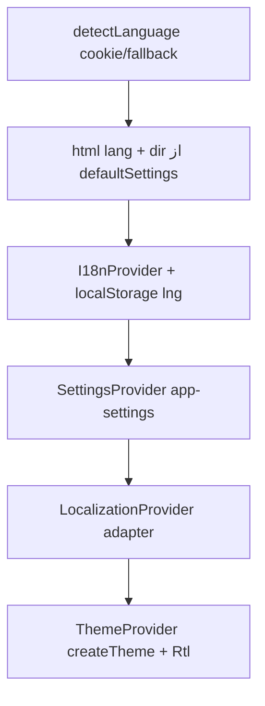

# MUI، تم، i18n و RTL

شناسهٔ کاتالوگ: `27-mui-i18n`.

ارجاع: [23-nextjs](23-nextjs.md)، [24-vite-access-control](24-vite-access-control.md)، [25-api-client-auth](25-api-client-auth.md)، [26-client-state](26-client-state.md).

مسیرها نسبت به `dejban_frontend_new`. اپ زنده و سوئیچ زبان در مرورگر اجرا نشد. `17`/`18` و جزئیات device خارج از محدوده.

## 1. نقش MUI و `@repo/ui`

Material UI اسکلت UI (Button، Layout، CssBaseline، color schemes) است. در اپ‌ها معمولاً `@mui/material` حدود `^7.3.2`، همراه Emotion (`@emotion/react` / `styled` / `cache`)، و برای RTL `@mui/stylis-plugin-rtl` (+ اغلب `stylis-plugin-rtl` در package.json).

پکیج `@repo/ui` تم مشترک، layout داشبورد، Settings، و بخشی از locales را export می‌کند (`ThemeProvider`، `themeConfig`، `LanguagePopover`، `useTranslate`، …). هر اپ namespaceهای ترجمه و گاهی `locales-config` خود را زیر `src/locales` نگه می‌دارد و `transpilePackages` آن را به Next/Vite می‌دهد.

این درس client-state (RQ/SWR) را تکرار نمی‌کند؛ Settings فقط جایی که به direction/theme وصل است.

## 2. درخت provider و ساخت تم

نمونهٔ Next (dejban `src/app/layout.jsx`):

1. `html` با `lang` از `detectLanguage()` و `dir` از `defaultSettings.direction` (پیش‌فرض RTL در settings/theme)
2. `InitColorSchemeScript` با `themeConfig.modeStorageKey` / `cssVariables.colorSchemeSelector`
3. `I18nProvider` → Auth → `SettingsProvider` → `LocalizationProvider` → `ThemeProvider` → …

`ThemeProvider` (`packages/ui/src/theme/theme-provider.jsx`):

- از `useSettingsContext().state` و `useTranslate().currentLang.systemValue` تم می‌سازد
- `createTheme({ settingsState, localeComponents, themeOverrides })`
- `ThemeVarsProvider` + `CssBaseline` + `Rtl direction={settings.state.direction}`

`createTheme` / `baseTheme`:

- `colorSchemes.light` و `.dark` با palette/shadows
- `components` overrideهای هسته
- `typography`، `shape.borderRadius: 8`
- `direction` اولیه از `themeConfig.direction` (`'rtl'`)
- `applySettingsToTheme` جهت، فونت، contrast، primaryColor preset را روی core می‌نشاند
- `localeComponents` همان localeهای MUI/X از `allLangs[].systemValue` است — **جدا از** رشته‌های i18next

فونت پیش‌فرض تم: `IRANSansWeb` / `IRANSansWeb_Fanum` در `theme-config.js`.

## 3. RTL و استایل Emotion

`Rtl` (`with-settings/right-to-left.jsx`):

- `useEffect`: `document.dir = direction`
- اگر `direction === 'rtl'`: `CacheProvider` با Emotion cache کلید `rtl` و `stylisPlugins: [rtlPlugin]` از `@mui/stylis-plugin-rtl`
- اگر LTR: children بدون آن cache

پس RTL فقط با داشتن dependency ثابت نمی‌شود؛ به `settings.state.direction` و این wrapper وابسته است. تغییر زبان باید direction را در settings آپدیت کند (مسیر پایین) تا تم و stylis هم‌راستا شوند.

**Verified:** ترجمه‌ی متن به‌تنهایی `document.dir` را عوض نمی‌کند؛ کد صریحاً `updateDirection` / `Rtl` را صدا می‌زند.

## 4. i18n اپ در برابر locale MUI

| لایه | چیست | شاهد |
|---|---|---|
| i18next + react-i18next | رشته‌های UI از JSON | `I18nProvider`، `useTranslate` → `t(...)` |
| MUI/`systemValue` | برچسب‌های داخلی DatePicker/DataGrid/Core | `allLangs[].systemValue` → `createTheme(..., localeComponents)` |
| Date adapter | تقویم جلالی در برابر میلادی | `LocalizationProvider`: fa → `AdapterMomentJalaali`؛ وگرنه `AdapterDayjs` |

زبان‌های **پیکربندی‌شده** در dejban/UI package:

- `supportedLngs`: `fa-IR`، `en-US`
- `fallbackLng`: `fa-IR`
- `RTLLanguages`: فقط `['fa-IR']`
- `defaultNS`: `common`

پوشه‌های `langs/fa-IR` و `langs/en-US` در اپ‌ها (و تعداد محدود در `@repo/ui`). **عربی (`ar`) در `supportedLngs` و درخت langs بررسی‌شده نیست** — ادعای پشتیبانی عربی از روی سورس فعلی تأیید نشد.

منابع با `i18next-resources-to-backend`: `import(./langs/${lang}/${namespace}.json)`.

Persist زبان:

- localStorage کلید `i18nextLng`
- cookie کلید `i18next` (detection caches در client)
- SSR Next: `detectLanguage()` اول cookie، بعد در صورت `autoDetection` هدر (فعلاً `cookie.autoDetection: false` پس هدر عملاً برای cookie-config خاموش است)، بعد fallback

هدر API: Axios `Accept-Language` از `localStorage.i18nextLng` یا `fa-IR` (درس 25).

## 5. وقتی کاربر زبان یا تم را عوض می‌کند

### زبان (UI)

`LanguagePopover` در dashboard layout → `onChangeLang(lang)` از `useTranslate`:

1. `i18n.changeLanguage(lang)` (+ toast loading/success/error)
2. `settings.setState({ direction: i18n.dir(lang) })`
3. `dayjs.locale(adapterLocale)`
4. نوشتن `direction` در `localStorage` `app-settings` (best-effort)
5. `router.refresh()` — کامنت کد: فقط Next؛ در Vite اثر ممکن است محدود/نه

سپس `ThemeProvider` با `currentLang.systemValue` و `settings.state` تم را دوباره `useMemo` می‌کند؛ `Rtl` با direction جدید `document.dir` و cache RTL را تنظیم می‌کند.

`useLocaleDirectionSync` برای هم‌تراز کردن `document.dir` و settings با زبان وجود دارد؛ **call site mount در اپ‌ها در این فاز یافت نشد** (فقط export). هم‌ترازی اصلی از مسیر `onChangeLang` و مقدار اولیه‌ی settings است.

### تم / mode

`themeConfig.defaultMode: 'light'`؛ `modeStorageKey: 'theme-mode'`؛ color scheme با `data-color-scheme` از CssVars. Settings drawer/`SettingsProvider` حالت و رنگ را در `app-settings` نگه می‌دارد (درس 26). جزئیات تک‌تک کنترل‌های drawer اینجا تکرار نمی‌شود.

## 6. تفاوت اپ‌ها

| موضوع | Next (dejban/main/…) | access-control (Vite) |
|---|---|---|
| `detectLanguage` / cookie SSR | بله در root layout | خیر؛ فقط client i18n |
| حجم JSON ترجمه | خیلی زیاد (ده‌ها namespace در dejban) | کم (common/navbar/user/device/report) |
| `locales-config` اپ | کامل با MUI locale merge (dejban) | ساده‌تر؛ `languages` fa/en بدون systemValue در فایل کوتاه ACL |
| `LocalizationProvider` / Jalali | از `@repo/ui` (re-export) | همان الگوی provider در app tree |
| `router.refresh` بعد از زبان | معنادار در Next | در Vite معمولاً بی‌اثر یا محدود (`inference` از API روتر) |
| Theme/Rtl مشترک | `@repo/ui/theme` | همان |

main نسبت به dejban namespaceهای کمتر دارد؛ gate/dcc مشابه الگوی Next با تم مشترک.

## 7. دو مسیر اجرا

### A) Bootstrap اولیه (Next dejban)

### B) تعویض زبان از هدر داشبورد

`LanguagePopover` → `onChangeLang` → i18n + direction settings + dayjs + app-settings + refresh → تم/Rtl/locale MUI به‌روز.

اجرای زندهٔ UI: `Runtime verification pending`.

## 8. محدودیت‌ها و ناسازگاری‌ها

| یافته | برچسب |
|---|---|
| فقط fa-IR و en-US در supported list | verified؛ عربی تأیید نشد |
| i18n رشته ≠ MUI locale | verified دو مسیر جدا |
| `dir` اولیهٔ html از settings پیش‌فرض است نه لزوماً از زبان detect‌شده | verified در `getAppConfig` |
| `useLocaleDirectionSync` بدون call site اپ | export موجود؛ استفادهٔ mount یافت نشد |
| ACL `locales-config` بدون `systemValue` MUI | ممکن است locale کامپوننت X از مسیر ThemeProvider/`src/locales` اپ تأمین شود یا ناقص بماند — بستگی به اینکه `allLangs` از کدام ماژول resolve شود (`inference` روی bundler alias) |
| کامل بودن ترجمه همهٔ کلیدها | وجود فایل ≠ پوشش ۱۰۰٪؛ runtime pending |
| فونت IRANSans باید در CSS/asset لود شود | نام در theme؛ لود فونت در این فاز خط‌به‌خط فایل فونت verify نشد |

## 9. ده سؤال مصاحبه

### 1. تم مشترک کجا ساخته می‌شود؟

`createTheme` در `@repo/ui`؛ `ThemeProvider` آن را با settings و `localeComponents` زبان جاری می‌سازد.

### 2. RTL چطور به CSS Emotion می‌رسد؟

وقتی direction برابر `rtl` است، `Rtl` یک Emotion cache با `rtlPlugin` می‌گذارد و `document.dir` را ست می‌کند.

### 3. آیا عوض کردن زبان خودش RTL می‌کند؟

فقط اگر مسیر `onChangeLang` → `i18n.dir(lang)` → `settings.setState({ direction })` اجرا شود؛ صرف `t()` کافی نیست.

### 4. فرق i18next و `systemValue`؟

اولی متن‌های اپ از JSON؛ دومی locale آبجکت MUI/X برای کامپوننت‌های داخلی.

### 5. زبان پیش‌فرض چیست؟

`fallbackLng` / پیش‌فرض ذخیره‌نشده: `fa-IR`.

### 6. برای فارسی تاریخ‌ها چه adapterی است؟

`AdapterMomentJalaali` وقتی `currentLang.value === 'fa-IR'`؛ وگرنه `AdapterDayjs`.

### 7. زبان انتخابی چطور به API می‌رود؟

Interceptor Axios هدر `Accept-Language` را از `i18nextLng` می‌خواند.

### 8. عربی پشتیبانی می‌شود؟

در `supportedLngs` و پوشه‌های langs بررسی‌شده نیست؛ ادعای پشتیبانی عربی از این شاهدها نمی‌آید.

### 9. Light/dark از کجا می‌آید؟

`colorSchemes` در `baseTheme` + CssVars/`InitColorSchemeScript` و تنظیمات کاربر در Settings (کلید mode در theme-config).

### 10. چرا `router.refresh` بعد از تغییر زبان؟

برای هم‌تراز کردن بخش‌های RSC/Next با زبان جدید؛ در Vite معادل قوی ندارد.

**Follow-up:** cookie زبان SSR؟  
کلید `i18next`؛ `detectLanguage` آن را می‌خواند. `autoDetection` از Accept-Language هدر در config فعلی false است.

## 10. خلاصه و چک‌لیست

- [ ] درخت I18n → Settings → Localization → Theme → Rtl را بلدم.  
- [ ] می‌دانم RTL با stylis plugin و `document.dir` است.  
- [ ] fa/en را از عربیِ ادعا‌نشده جدا می‌کنم.  
- [ ] MUI locale را از i18next جدا می‌گویم.  
- [ ] مسیر LanguagePopover تا direction را شرح می‌دهم.

## 11. منابع

- `packages/ui/src/theme/{theme-provider,create-theme,theme-config}.js(x)`
- `packages/ui/src/theme/with-settings/right-to-left.jsx`، `update-core.js`
- `packages/ui/src/locales/{use-locales,localization-provider,locales-config,i18n-provider}.*`
- `packages/ui/src/layouts/components/language-popover.jsx`
- `packages/ui/src/layouts/dashboard/layout.jsx` — `LanguagePopover` + `allLangs`
- `apps/dejban/src/app/layout.jsx`، `locales/{locales-config,i18n-provider,server}.js`
- `apps/access-control/src/locales/locales-config.js`، `langs/*`
- `apps/main/src/locales/langs/*`
- `packages/api-client/src/axiosInstance.ts` — `Accept-Language`
- `packages/ui/src/components/settings/settings-config.js` — `direction` پیش‌فرض
