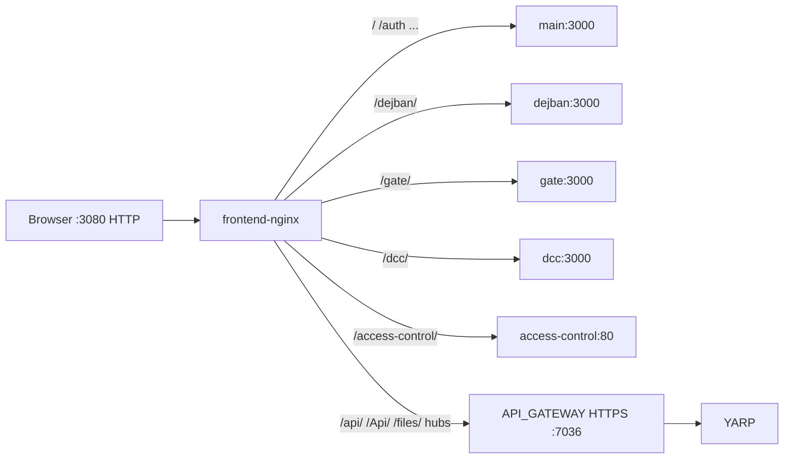

# Nginx به‌عنوان لبهٔ مرورگر

شناسهٔ کاتالوگ: `28-nginx-edge`.

ارجاع: [03-docker-compose](03-docker-compose.md)، [04-yarp](04-yarp.md)، [13-signalr](13-signalr.md)، [22-turborepo](22-turborepo.md)، [23-nextjs](23-nextjs.md)، [24-vite-access-control](24-vite-access-control.md)، [00-api-path-case-investigation](00-api-path-case-investigation.md).

مسیرهای Nginx نسبت به ریشهٔ `dejban_frontend_new` هستند مگر خلافش گفته شود. کانتینر Nginx، Docker، و درخواست HTTP در این فاز اجرا نشدند. `17`/`18` خارج از محدوده؛ نام hubهایی مثل `baskoolhub` فقط به‌عنوان رشتهٔ location ذکر می‌شود نه بررسی محصول Baskool.

## 1. نقش Nginx در این معماری

در استک فرانت، Nginx **لبهٔ HTTP مرورگر** است:

- پورت منتشرشدهٔ هاست (پیش‌فرض `3080`) → `listen 80` داخل کانتینر
- مسیرهای UI را به کانتینرهای Next/Vite می‌فرستد
- `/api/`، `/Api/`، `/files/` و چند hub SignalR را با HTTPS به API Gateway (YARP) روی پورت نمونهٔ `7036` می‌فرستد
- TLS را برای مرورگر روی این لبه terminate نمی‌کند (فقط HTTP)؛ به gateway با HTTPS و `proxy_ssl_verify off` وصل می‌شود (مناسب cert دولوپری)

لایهٔ بعد از API روی gateway همان YARP است (درس 04). Nginx مسیر را برای `/api/` rewrite نمی‌کند؛ فقط proxy می‌کند.

**دو استک انتخاب‌پذیر در repo فرانت:**

| فایل Compose | قالب Nginx mount‌شده | هدف |
|---|---|---|
| `docker-compose.yml` | `docker/nginx/default.conf.template` | استک کامل: nginx + اپ‌های container |
| `docker-compose.nginx-only.yml` | `docker/nginx/nginx-only.conf.template` | فقط nginx؛ اپ‌ها روی پورت‌های host (dev) |

هر دو volume را روی `/etc/nginx/templates/default.conf.template` می‌گذارند. ایمیج رسمی `nginx:1.27-alpine` قالب‌های آن پوشه را با envsubst به `conf.d` می‌سازد (`verified` قرارداد ایمیج + mount؛ ساخت conf زنده pending).

سومین فایل: `docker/nginx/access-control.conf` — **داخل image خود سرویس access-control** کپی می‌شود (`Dockerfile.access-control` → `/etc/nginx/conf.d/default.conf`)، نه به‌عنوان لبهٔ بیرونی کل استک. لبهٔ Compose به upstream `access-control:80` پروکسی می‌کند و آن کانتینر SPA را با `try_files` سرو می‌کند.

مسیر CI/pm2 درس 22 لزوماً همین Compose nginx را بالا نمی‌آورد — محیط deploy جدا ممکن است (`inference` از وجود دو مسیر؛ هم‌زیستی runtime pending).

## 2. نقشهٔ درخواست (استک کامل)

Upstreamهای `default.conf.template`:

- `frontend_main` → `main:3000`
- `frontend_dejban` → `dejban:3000`
- `frontend_gate` → `gate:3000`
- `frontend_dcc` → `dcc:3000`
- `frontend_access_control` → `access-control:80`

Env: `API_GATEWAY` پیش‌فرض `host.docker.internal:7036`؛ شبکهٔ Compose فرانت به بک‌اند attach نیست (`docker-compose.yml` کامنت + README).

## 3. Nginx در برابر YARP

| لایه | کار |
|---|---|
| Nginx لبه | host/path سطح origin مرورگر؛ جدا کردن اپ‌های UI؛ تونل API/files/hub به یک آدرس gateway |
| YARP (ApiGateway) | match دقیق routeهای `/Api/v{apiVersion}/...` و hubها به میکروسرویس‌ها |

فرانت با base نسبی `/api/v1` درخواست می‌زند → Nginx `location /api/` → HTTPS gateway بدون عوض کردن URI → YARP. جزئیات حروف `/api` vs `/Api`: سند `00-api-path-case-investigation.md` (هر دو location در Nginx هستند).

## 4. locationها و هم‌ترازی basePath

### API و فایل و hub (`default.conf.template`)

| location | هدف |
|---|---|
| `/api/` | `https://${API_GATEWAY}` + `proxy_ssl_verify off` |
| `/Api/` | همان |
| `/files/` | همان (DCC عمومی از مسیر gateway؛ درس 16) |
| regex hubها | `tickethub\|platereaderhub\|devicehub\|ssmhub\|vehiclepolicyhub\|manualaccesshub\|baskoolhub\|timeserverhub` → gateway |

WebSocket: `map $http_upgrade`، `proxy_http_version 1.1`، هدرهای `Upgrade`/`Connection`، timeout خواندن/نوشتن `3600s`.

**شکاف verified (درس 13):** `gateStatusHub` و `useractivityhub` در این regex نیستند، در حالی که در بک‌اند/YARP مسیر دارند.

gRPC / `grpc_pass` / HTTP/2 صریح در این قالب‌ها **نیست**.

### اپ‌های UI

| location | basePath / Vite base اپ | یادداشت |
|---|---|---|
| `= /dejban` و `/dejban/` | Next `basePath: '/dejban'` | exact + prefix |
| `/gate/` | `/gate` | بدون `location = /gate` در قالب کامل |
| `/dcc/` | `/dcc` | مشابه |
| `/access-control/` | Vite `base` / basename `/access-control` | به nginx داخلی SPA |
| `/` | main بدون basePath | catch-all؛ login روی main |

هم‌ترازی پیشوند مسیر با `basePath`/`VITE_BASE` از روی مقادیر ثابت config و location: **سازگار به‌نظر می‌رسد** (`verified` مقادیر؛ رفتار 3080 زنده pending).

`nginx-only`: اپ‌ها روی `HOST_GATEWAY:3031/3034/3036/3037/3033`؛ `/` به 3031؛ `location = /` → `302 /dejban`.

### SPA داخلی access-control

`try_files $uri $uri/ /access-control/index.html`؛ `location = /` → `302 /access-control/`.

## 5. هدرها، TLS، محدودیت‌ها

از بلوک `server` قالب لبه:

| تنظیم | مقدار |
|---|---|
| `listen` | `80` فقط — بدون `listen 443` در این فایل‌ها |
| `client_max_body_size` | `100m` |
| `proxy_read_timeout` / `proxy_send_timeout` | `3600s` |
| Forward headers | `Host $http_host`، `X-Real-IP`، `X-Forwarded-For`، `X-Forwarded-Proto $scheme` |
| TLS به upstream API | HTTPS + `proxy_ssl_verify off` + `proxy_ssl_server_name on` |
| TLS مرورگر | در این قالب‌ها پیکربندی نشده |

`$scheme` روی لبهٔ HTTP معمولاً `http` است؛ اینکه gateway با KnownProxies این هدرها را بپذیرد موضوع درس 04 است (IP پروکسی Docker ≠ loopback → ریسک rate-limit روی IP Nginx).

صفحهٔ error اختصاصی یا health location روی این Nginx در قالب‌ها دیده نشد.

## 6. انتخاب پیکربندی

1. **تولید/لوکال استک فرانت کامل:** `docker compose up` از ریشهٔ فرانت → سرویس `nginx` + mount `default.conf.template` + env `API_GATEWAY`.
2. **Smoke بدون بیلد اپ:** `docker compose -f docker-compose.nginx-only.yml` → `nginx-only.conf.template` + `HOST_GATEWAY`.
3. **کانتینر ACL:** image با `access-control.conf` ثابت (بدون template envsubst برای API).

کدام روی سرور مشتری واقعاً Up است: از روی repo به‌تنهایی قطعی نیست → `Runtime verification pending` / docs offline به `frontend-nginx` و `API_GATEWAY` اشاره دارند.

## 7. ریسک‌ها و mismatchها

| موضوع | برچسب |
|---|---|
| hubهای گیت/فعالیت کاربر خارج regex | verified gap |
| فقط HTTP روی لبه؛ cookie `Secure` بک‌اند روی IP غیر-localhost | README فرانت هشدار می‌دهد؛ runtime cookie pending |
| `proxy_ssl_verify off` | مناسب dev؛ ریسک MITM اگر در prod همان بماند — آیا prod همین فایل است: unconfirmed |
| شبکه جدا از بک‌اند | verified؛ وابستگی به `host.docker.internal` |
| CI pm2 vs Compose nginx | دو مسیر deploy محتمل |
| `/gate` بدون trailing در فقط-nginx vs `/gate/` در کامل | تفاوت قالب‌ها |
| نام `baskoolhub` در regex | فقط routing؛ محصول Baskool خارج محدوده |

## 8. ده سؤال مصاحبه

### 1. Nginx در این پروژه چه کاری می‌کند که YARP نمی‌کند؟

جدا کردن اپ‌های فرانت روی یک origin و پنهان کردن HTTPS/cert دولوپری gateway از مرورگر؛ YARP بعداً API را به سرویس‌ها می‌شکند.

### 2. مرورگر چطور به API بدون دیدن پورت 7036 می‌رسد؟

درخواست به `http://localhost:3080/api/v1/...` → Nginx `location /api/` → `https://API_GATEWAY`.

### 3. چرا هم `/api/` و هم `/Api/` هست؟

دو prefix location جدا بدون rewrite؛ فرانت داکر `/api` می‌سازد؛ الگوی YARP اغلب `/Api` است — هر دو به gateway می‌روند (جزئیات match: سند حروف مسیر).

### 4. WebSocket چطور پشتیبانی شده؟

`Upgrade`/`Connection` از map، HTTP/1.1، timeout یک‌ساعته؛ برای hubهای لیست‌شده در regex.

### 5. چرا `gateStatusHub` ممکن است از لبه نرسد؟

در regex Nginx نیست؛ درخواست به `/gateStatusHub` ممکن است به `location /` و اپ main برود نه gateway.

### 6. TLS کجا terminate می‌شود؟

روی این لبهٔ فرانت در قالب‌های فعلی terminate نمی‌شود (پورت 80). ارتباط nginx→gateway HTTPS است با verify خاموش.

### 7. فرق `default.conf.template` و `access-control.conf`؟

اولی لبهٔ چند-upstream است؛ دومی فقط static SPA داخل کانتینر ACL.

### 8. `client_max_body_size 100m` برای چیست؟

سقف حجم بدنهٔ درخواست از طریق این پروکسی (آپلود و مشابه)؛ مقدار دقیق نیاز محصول runtime نیست.

### 9. استک nginx-only چه زمانی؟

تست پروکسی بدون بیلد Next؛ ترافیک UI به پورت‌های dev روی host.

### 10. رابطه با ForwardedHeaders گیت‌وی؟

Nginx `X-Forwarded-*` و `X-Real-IP` می‌گذارد؛ اگر IP کانتینر nginx در KnownProxies نباشد، گیت‌وی ممکن است IP کلاینت واقعی را نبیند (درس 04).

**Follow-up:** آیا gRPC از این Nginx رد می‌شود؟  
در قالب‌ها `grpc_pass` نیست؛ مسیر دستگاه gRPC معمولاً خارج این لبه است (درس 14).

## 9. خلاصه و چک‌لیست

- [ ] نقش لبهٔ فرانت در برابر YARP را بلدم.  
- [ ] جدول locationهای UI و API را از template می‌گویم.  
- [ ] شکاف hubهای SignalR را می‌شناسم.  
- [ ] دو Compose و conf داخلی ACL را از هم جدا می‌کنم.  
- [ ] می‌دانم TLS مرورگر روی این فایل‌ها نیست.

## 10. منابع

- `dejban_frontend_new/docker/nginx/default.conf.template`
- `dejban_frontend_new/docker/nginx/nginx-only.conf.template`
- `dejban_frontend_new/docker/nginx/access-control.conf`
- `dejban_frontend_new/docker-compose.yml`
- `dejban_frontend_new/docker-compose.nginx-only.yml`
- `dejban_frontend_new/docker/Dockerfile.access-control`
- `dejban_frontend_new/docker/README.md`
- `docs/technical-learning/00-api-path-case-investigation.md`
- `docs/technical-learning/04-yarp.md`، `13-signalr.md`
