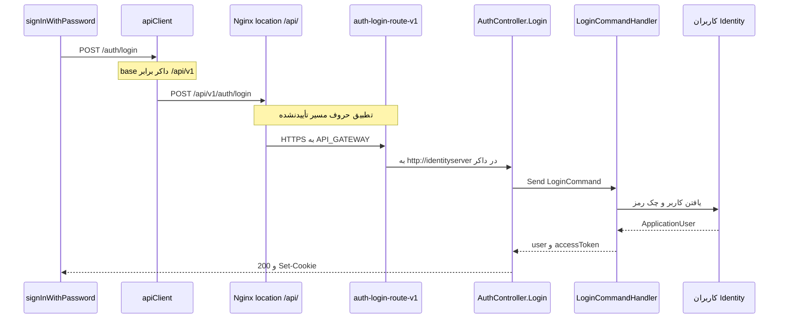
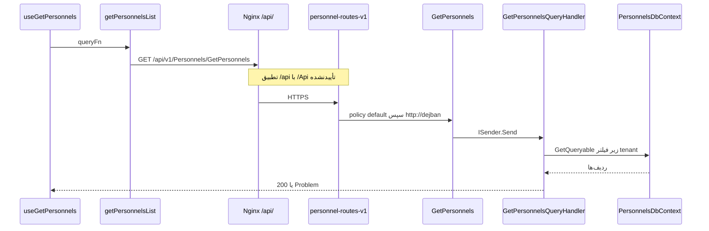

# دو مسیر درخواست: ورود و فهرست پرسنل

شناسهٔ کاتالوگ: `30-request-paths`.

این سند دو عملیات واقعی را از مرورگر تا دیتابیس دنبال می‌کند. مدل میزبان در `01-dotnet-aspnetcore.md` است و جدول YARP در `04-yarp.md`. اینجا فقط زنجیرهٔ همین دو درخواست است.

هیچ‌کدام از این مسیرها در این فاز با مرورگر یا curl اجرا نشد. هر hop یا از کد و پیکربندی است، یا صریحاً تأییدنشده است.

## چرا این دو درخواست

ورود توکن را می‌سازد و route درگاهش `anonymous` است. فهرست پرسنل یک GET محافظت‌شده روی دژبان است، از React Query می‌آید، و به schema پرسنل در PostgreSQL می‌رسد. با همین دو تا، هم مسیر بدون توکن دیده می‌شود و هم مسیری که توکن، سایت، و مجوز می‌خواهد.

## قرارداد مشترک کلاینت

`packages/api-client/src/axiosInstance.ts` تابع `createApiClient` را می‌سازد و `apiClient` را با `resolveBaseUrl()` export می‌کند. اگر `NEXT_PUBLIC_SERVER_URL` باشد همان base است. وگرنه برای Vite مقدار `VITE_SERVER_URL` خوانده می‌شود. اگر هیچ‌کدام نباشد base خالی است.

Compose فرانت در `dejban_frontend_new/docker-compose.yml` برای ایمیج dejban آرگومان `NEXT_PUBLIC_SERVER_URL` را `/api/v1` می‌گذارد. این مقدار زمان build داخل باندل می‌رود. فایل env توسعه در این سند باز نشد، پس base روی `npm run dev` بدون آن متغیر تأیید نشد.

`endpoints.auth.login` برابر `/auth/login` است. در ایمیج داکر فرانت، URL ورود برابر `/api/v1/auth/login` است.

`withCredentials: true` است تا cookie با درخواست برود. interceptor قبل از ارسال این کارها را می‌کند:

- `Accept-Language` را از `localStorage` با کلید `i18nextLng` می‌گذارد و اگر نباشد `fa-IR`
- `X-Site-Id` را از `useSiteStore.getState().getSiteIds()` با کاما جدا می‌کند، مگر روی خود config درخواست `siteId` باشد
- اگر URL درخواست refresh نباشد و توکن در `tokenStorage` باشد، `Authorization: Bearer` می‌گذارد
- رقم فارسی و عربی داخل params و JSON و `FormData` را به رقم انگلیسی تبدیل می‌کند

اگر وضعیت 503 باشد و `window` وجود داشته باشد، مرورگر به `/error/503?system=...` می‌رود. نام سیستم از `error.response.data.systemName` است. این فیلد را `ProxyErrorHandlingMiddleware` در بدنهٔ JSON می‌نویسد، به شرطی که آن middleware به نوشتن رسیده باشد.

اگر وضعیت 401 باشد، درخواست `_retry` نشده باشد، و URL شامل `/auth/login` یا `/auth/refresh` نباشد و تیکت عمومی هم نباشد، کلاینت یک بار `endpoints.auth.refresh` را می‌زند. ورود و تازه‌سازی وارد این حلقه نمی‌شوند.

## مسیر اول: ورود

`signInWithPassword` در `packages/ui/src/auth/context/jwt/action.js` با `{ username, password }` به `apiClient.post(endpoints.auth.login, ...)` می‌زند. از پاسخ، `accessToken` را در `tokenStorage` می‌گذارد و `user` یا کل `data` را برمی‌گرداند. در خطا، `title` یا `message` بدنه را پرتاب می‌کند و اگر نباشند متن `Login failed`.

1. بدنهٔ JSON کلیدهای `username` و `password` را دارد. `LoginCommand` در `Microservices/IdentityServer/Application/Auth/Commands/Login/LoginCommand.cs` پراپرتی‌های `UserName` و `Password` دارد. اینکه binder مقدار `username` را به `UserName` بچسباند در این فاز با درخواست دیده نشد. این hop تأییدنشده است. شکل هر دو طرف در کد مشخص است.

2. Axios مسیر نسبی را به base می‌چسباند. در build داکر dejban نتیجه `/api/v1/auth/login` است.

3. Nginx در `dejban_frontend_new/docker/nginx/default.conf.template` مکان `/api/` را به `https://${API_GATEWAY}` می‌فرستد و گواهی را verify نمی‌کند. پیش‌فرض `API_GATEWAY` برابر `host.docker.internal:7036` است. Compose بک‌اند پورت `7036:443` را برای `apigateway` منتشر می‌کند. کامنت Compose فرانت می‌گوید این stack به شبکهٔ بک‌اند وصل نیست. hop از Nginx به gateway از راه پورت host است. هدرهای `Host`، `X-Real-IP`، `X-Forwarded-For`، و `X-Forwarded-Proto` ست می‌شوند.

4. در محیط داکر، route `auth-login-route-v1` از `ApiGateway/appsettings.DockerDevelopment.json` بار می‌شود. الگو `/Api/v{apiVersion}/Auth/Login/{**catch-all}` است، policy برابر `anonymous`، rate limit برابر `Auth_RateLimiter_PerIp`، cluster برابر `identity-server-cluster`، و آدرس `http://identityserver`. transform مسیر را عوض نمی‌کند و `X-Forwarded-Proto` را `https` می‌گذارد. **تأییدنشده:** مسیریاب YARP رشتهٔ `/api/v1/auth/login` را با الگوی `/Api/.../Auth/Login` یکی بگیرد. اگر نگیرد، زنجیره 404 می‌شود و به controller نمی‌رسد.

5. `AuthController.Login` مسیر کلاس `/api/v{version:apiVersion}/[controller]` دارد، متدش `[HttpPost("Login")]` و `[AllowAnonymous]` است، و نسخهٔ API برابر `1.0` است. `LoginCommand` به `ISender.Send` می‌رود و `result.Match(Ok, Problem)` برمی‌گردد. `Problem` روی `ApiController` نوع ErrorOr را به status code نگاشت می‌کند.

6. هویت `ValidationBehavior` را روی MediatR ثبت کرده است. `LoginCommandValidator` نام کاربری خالی را رد می‌کند. اگر `@` داشته باشد باید ایمیل باشد. اگر با الگوی موبایل `09` شروع شود باید با regex شماره همراه جور باشد. در غیر این صورت فقط حرف انگلیسی، عدد، و نقطه مجاز است. رمز نباید خالی باشد. پیام از `IStringLocalizer<ApiValidationResource>` می‌آید. behavior فقط وقتی پاسخ `IErrorOr` باشد بسته می‌شود. `LoginCommand` همین را برمی‌گرداند، پس validator قبل از handler در مسیر MediatR هست.

7. `LoginCommandHandler.Handle` کاربر را با `PayamGostarUserManager.Users` پیدا می‌کند: شماره، نام کاربری نرمال‌شده، یا ایمیل نرمال‌شده. `Sites` و `UserTokens` با `AsSplitQuery` لود می‌شوند. context هویت از `IdentityDbContext` است. نام دیتابیس `payamgostar_identity` از Compose سرویس identity است، نه از داخل این handler.

8. اگر کاربر نباشد، `IUserLoginLogger.LogAsync` با `UserLoginLogType.LoginFailed` صدا زده می‌شود و `Errors.Auth.InvalidCredentials` برمی‌گردد. اگر باشد، `SignInManager.CheckPasswordSignInAsync` با `lockoutOnFailure: true` رمز را چک می‌کند. قفل بودن `Errors.Auth.LockedOut` است. `IsNotAllowed` یعنی `Errors.Auth.DeActivated`. رمز غلط دوباره `InvalidCredentials` است.

9. در موفقیت، `TokenProvider.CreateAccessToken` توکن دسترسی می‌سازد. refresh با `GenerateUserTokenAsync` و `CreateRefreshToken` ساخته می‌شود و `SetAuthenticationTokenAsync` آن را با اطلاعات نشست ذخیره می‌کند. دو cookie به نام `ConfigConstants.AccessToken` و `ConfigConstants.RefreshToken` نوشته می‌شوند: `HttpOnly`، `Secure`، و `SameSite = None`. JSON پاسخ فقط `user` و `accessToken` است. refresh داخل JSON نیست. UI فقط `accessToken` را در storage می‌گذارد. **تأییدنشده:** cookie با `Secure` روی صفحهٔ HTTP ذخیره شود. template اناجین‌ایکس به کاربر روی پورت 80 سرو می‌دهد و به gateway با HTTPS وصل است. `Secure` ممکن است cookie را روی HTTP نچسباند. این از روی فلگ cookie است و در مرورگر آزمایش نشد.

10. پاسخ 200 از هویت به YARP و Nginx و Axios برمی‌گردد. اگر rate limit همان IP را رد کند، 429 قبل از هویت ساخته می‌شود. سقف 6 در 30 ثانیه و سقف سراسری 500 در دقیقه در سند YARP آمده و از `AddCustomRateLimiters` است.

## تصحیح فاز C

صفحهٔ «پرسنل» `useGetPersonnels` نیست. `apps/dejban/src/app/dashboard/personnel/staff/page.jsx` کامپوننت `StaffListView` را نشان می‌دهد و آن `useGetStaffWithPagination` را با `pageSize` برابر 10 صدا می‌زند. آدرس HTTP همان `endpoints.staff.list`، یعنی `/Personnels/GetPersonnels`، است. عدد 9999 فقط پیش‌فرض `getStaffWithPagination` است وقتی آرگومان `pageSize` نیاید. نقشهٔ کامل در `00-personnel-list-execution-path.md` است.

ورود از صفحهٔ `apps/main/src/app/auth/jwt/sign-in/page.jsx` به `apps/main/src/auth/context/jwt/action.js` می‌رود. تابع `packages/ui/src/auth/context/jwt/action.js` همان `post` را دارد. نقشهٔ کامل در `00-login-execution-path.md` است. بقیهٔ این درس عوض نشده است.

## مسیر دوم: فهرست پرسنل

`useGetPersonnels` در `dejban_frontend_new/apps/dejban/src/services/personnels/personnels.service.js` از `useQuery` استفاده می‌کند. این یک مصرف‌کنندهٔ دیگر همان endpoint است، نه خود صفحهٔ فهرست. کلید `personnelKeys.list` است و `queryFn` تابع `getPersonnelsList` است. `placeholderData` دادهٔ قبلی را تا رسیدن پاسخ جدید نگه می‌دارد.

`getPersonnelsList` در `apps/dejban/src/services/personnels/personnels.http.js` به `axiosInstance.get(endpoints.personnels.list, { params })` می‌زند. `apps/dejban/src/lib/api.js` در پایان `export default apiClient` دارد، پس این axios همان کلاینت مشترک است. `endpoints.personnels.list` برابر `/Personnels/GetPersonnels` است. پارامترها `page`، `pageSize`، `searchTerm`، `sortColumn`، `sortOrder`، و `filters` هستند. پیش‌فرض page برابر 1 و pageSize برابر 9999 است.

با base داکر، URL برابر `/api/v1/Personnels/GetPersonnels` به‌علاوهٔ query string است. توکن و، اگر store سایت خالی نباشد، `X-Site-Id` هم می‌روند.

1. تا Nginx همان مکان `/api/` است.

2. route `personnel-routes-v1` الگو را `/Api/v{apiVersion}/Personnels/{**catch-all}` گذاشته، policy برابر `default`، و cluster برابر `dejban-cluster`. در داکر آدرس `http://dejban` است. transform مسیر را بازنویسی نمی‌کند. `{**catch-all}` تکهٔ `GetPersonnels` را می‌پوشاند. **تأییدنشده:** تطبیق `/api` با `/Api`. نویسه‌های `Personnels` و `GetPersonnels` در کلاینت، الگو، و endpoint یکی هستند.

3. اگر درگاه توکن را نپذیرد، درخواست به دژبان نمی‌رسد. `OnMessageReceived` اول هدر Authorization را قبول می‌کند و interceptor همان را می‌فرستد. معنای کلمهٔ `default` در موتور YARP در سند YARP پرسش باز است. endpoint دژبان جداگانه `RequireAuthorization` دارد، پس بعد از پروکسی هم بدون کاربر 401 می‌شود.

4. `GetPersonnels.MapEndpoint` مسیر `/api/v{version:apiVersion}/Personnels/GetPersonnels` را با نسخهٔ `1.0` map می‌کند. `[AsParameters] GetPersonnelsQuery` فیلدهای `SearchTerm`، `SortColumn`، `SortOrder`، `Filters`، `Page`، و `PageSize` را دارد. کلاینت `searchTerm` می‌فرستد. **تأییدنشده:** چسبیدن نام query string به پراپرتی. این سومین hop تأییدنشده است.

5. `ValidationPipelineBehavior` دژبان فقط برای `TRequest : IBaseCommand` است. `GetPersonnelsQuery` اینترفیس `IQuery<PagedList<object>>` و `IPagedQuery` را پیاده می‌کند، نه `IBaseCommand`. قید generic یعنی این behavior برای فهرست پرسنل انتخاب نمی‌شود. اعتبار صفحه و فیلتر و مرتب‌سازی داخل `GetPersonnelsQueryHandler.Handle` است: `ValidatePagination`، `ValidateFilters` با `_filterMap`، و `ValidateSorting` با `_sortMap`. شکست `Error.Failure` است و endpoint با `ApiResults.Problem` آن را HTTP می‌کند.

6. `ExceptionHandlingPipelineBehavior` برای هر `TRequest : class` است. `RequestLoggingPipelineBehavior` علاوه بر آن پاسخ `IErrorOr` می‌خواهد. این کوئری هر دو را دارد، پس آن دو behavior در ثبت `AddApplication` برایش قابل اعمال‌اند. ترتیب ثبت: exception، logging، validation. validation به‌خاطر قید command در این GET شرکت نمی‌کند.

7. handler از `personnelRepository.GetQueryable().AsNoTracking()` شروع می‌کند. اگر `UserId` یک Guid باشد و `HasPermissionAsync(PersonnelPermissions.StaffView)` false باشد، شرط `personnel.Id == userId` اضافه می‌شود. این Forbid نیست. لیست به همان کاربر محدود می‌شود. جست‌وجو روی نام، کد پرسنلی، کد ملی، موبایل، سایت، واحد، سمت، نوع و وضعیت استخدام، مدرک، و رشته است. اگر ستون مرتب‌سازی خالی باشد، `createdat` نزولی می‌شود. قراردادها از `contractRepository` روی `ContractIds` می‌آیند.

8. `PersonnelsDbContext` در سازنده `ITenantContext` می‌گیرد. `TenantIds` از `SiteIds` است. `OnModelCreating` هم `ApplyTenantQueryFilters(this)` را صدا می‌زند و هم `ApplySoftDeleteQueryFilters` را. میان‌افزار tenant در دژبان بعد از authorization و قبل از endpoint است، پس هنگام handler سایت مؤثر ست شده است. اگر هدر `X-Site-Id` خالی باشد، `TenantContextMiddleware` سایت‌های claim را برمی‌دارد. اگر کاربر super-admin نباشد، اشتراک هدر و claim استفاده می‌شود.

9. repository پرسنل `AddScoped` است. connection همان `Postgres` است که Compose آن را به دیتابیس `payamgostar_dejban` می‌دهد و schema ماژول `personnels` است. handler SQL دستی ندارد. Dapper در این handler دیده نشد.

10. `result.Match(Results.Ok, ApiResults.Problem)` یا 200 است یا ProblemDetails. React Query داده را زیر کلید لیست نگه می‌دارد. اگر دژبان از درگاه قطع باشد، 502 ممکن است به 503 با `systemName` تبدیل شود و interceptor فرانت صفحهٔ خطا را باز کند.

## خطا کجا ساخته می‌شود

| نشانه | سازنده | شاهد |
|---|---|---|
| نام کاربری یا رمز خالی | `LoginCommandValidator` از راه `ValidationBehavior` | قبل از handler ورود |
| رمز غلط یا کاربر نبود | `Errors.Auth.InvalidCredentials` | داخل `LoginCommandHandler` |
| قفل حساب | `Errors.Auth.LockedOut` | `CheckPasswordSignInAsync` با lockout |
| 429 ورود | rate limiter درگاه | `Auth_RateLimiter_PerIp` و limiter سراسری |
| 401 پرسنل | policy درگاه و `RequireAuthorization` | توکن غایب یا نامعتبر |
| فیلتر یا صفحهٔ نامعتبر | خود handler پرسنل | `ValidateFilters` و دو متد کناری |
| بدون مجوز StaffView | همان handler | `Where` روی `Id`، نه status 403 |
| 503 دوستانه | `ProxyErrorHandlingMiddleware` | بعد از 502 یا 500، سپس redirect فرانت |
| 401 بعد از انقضای توکن در درخواست‌های دیگر | interceptor Axios | refresh، به‌جز login و refresh و تیکت عمومی |

## چه چیزی در نمودار نیست

نمودارها RabbitMQ، Quartz، و Redis را در این دو درخواست نشان نمی‌دهند. ورود توکن را در دیتابیس هویت ذخیره می‌کند. blacklist ردیس مال رد کردن توکن است، نه مال login موفق. فهرست پرسنل در این handler رویداد منتشر نمی‌کند.

hopهای تأییدنشده فقط Note هستند:

- حروف `/api` در برابر `/Api` و `auth/login` در برابر `Auth/Login`
- چسبیدن `username` به `UserName` و `searchTerm` به `SearchTerm`
- ذخیرهٔ cookie با `Secure` وقتی صفحه HTTP است
- base URL وقتی `NEXT_PUBLIC_SERVER_URL` در dev ست نشده باشد

## رابطه با سندهای بعدی

| موضوع | سند |
|---|---|
| ترتیب middleware | `01-dotnet-aspnetcore.md` |
| cluster و تبدیل 502 | `04-yarp.md` |
| JWT و Identity | `05-jwt-identity.md` |
| فیلتر سایت | `06-tenancy-authorization.md` |
| اینکه validation دژبان مخصوص command است | `08-cqrs-mediatr.md` |
| schema `personnels` | `09-ef-core-postgresql.md` |
| جزئیات refresh | `25-api-client-auth.md` |
| Nginx | `28-nginx-edge.md` |

## سؤال‌های مصاحبه

### 1. از کلیک ورود تا نوشتن توکن، کدام پردازه رمز را می‌بیند؟

IdentityServer. مرورگر JSON را به Axios می‌دهد، Nginx و YARP بدنه را عبور می‌دهند، و `LoginCommandHandler` رمز را به `CheckPasswordSignInAsync` می‌دهد. route درگاه cluster هویت است، نه `dejban-cluster`. دژبان در این درخواست نیست.

دنباله: refresh token کجا می‌ماند؟

جواب: در JSON پاسخ نیست. handler آن را hash می‌کند، با `SetAuthenticationTokenAsync` ذخیره می‌کند، و cookie با `HttpOnly` می‌نویسد. `signInWithPassword` فقط `accessToken` را در storage می‌گذارد.

### 2. چرا URL کلاینت با الگوی YARP عین هم نیست؟

کلاینت `/api/v1/auth/login` می‌سازد. YARP الگوی `/Api/v{apiVersion}/Auth/Login/{**catch-all}` دارد. Controller مسیر `/api/v{version}/Auth/Login` را دارد. `{apiVersion}` و `{**catch-all}` عمدی‌اند. تفاوت `Api` و `api` اگر فقط به‌خاطر بی‌تفاوتی مسیریاب کار کند، قرارداد نانوشته است. این تطبیق اجرا نشد. اگر مسیریاب حساس به حروف باشد، 404 از درگاه می‌آید و validator هویت اجرا نمی‌شود.

دنباله: کدام بخش مسیر واقعاً یکسان نوشته شده است؟

جواب: کلمات `Personnels` و `GetPersonnels` در `endpoints.personnels.list`، در الگوی `personnel-routes-v1`، و در `MapGet` دژبان یکی هستند. اختلاف باقی‌مانده برای آن درخواست، پیشوند `/api` در برابر `/Api` است.

### 3. 401 ورود با 401 فهرست پرسنل یکی است؟

نه. login روی درگاه `anonymous` است و action هم `[AllowAnonymous]` دارد. شکست رمز از handler به‌صورت ErrorOr برمی‌گردد، نه به‌خاطر نبودن هدر Authorization روی خود POST ورود. فهرست پرسنل هم policy درگاه و هم `RequireAuthorization` دارد.

دنباله: interceptor با 401 چه می‌کند؟

جواب: در `axiosInstance.ts` اگر وضعیت 401 باشد و URL شامل `/auth/login` یا `/auth/refresh` نباشد و تیکت عمومی نباشد، یک بار `POST` به `endpoints.auth.refresh` می‌زند. خود ورود وارد این حلقه نمی‌شود. اگر refresh هم 401 یا 403 یا 404 بدهد، پنجرهٔ بلاک صفر می‌شود. برای خطاهای دیگر، تا `REFRESH_RETRY_AFTER_MS` که 5000 است refresh دوباره شروع نمی‌شود.

### 4. FluentValidation فهرست پرسنل را کجا چک می‌کند؟

در این GET چک نمی‌کند. `ValidationPipelineBehavior` دژبان قید `IBaseCommand` دارد و `GetPersonnelsQuery` command نیست. صفحه و فیلتر و sort را خود handler با سه متد validate بررسی می‌کند و `Error.Failure` برمی‌گرداند. ورود برعکس است: `LoginCommand` درخواست MediatR با پاسخ `ErrorOr` است و `LoginCommandValidator` از راه `ValidationBehavior` هویت اجرا می‌شود.

دنباله: اگر کسی برای `GetPersonnelsQuery` یک `AbstractValidator` بسازد و در دژبان ثبت کند، این GET آن را می‌بیند؟

جواب: behavior فعلی به‌خاطر `where TRequest : IBaseCommand` برای این نوع ساخته نمی‌شود. validator تنها وقتی اثر دارد که یا قید behavior عوض شود، یا handler خودش validator را صدا بزند. امروز handler جدول `_filterMap` را دارد، نه FluentValidation.

### 5. کاربر بدون مجوز StaffView چه پاسخی می‌گیرد؟

اگر `UserId` پر باشد و `HasPermissionAsync(PersonnelPermissions.StaffView)` false باشد، handler کوئری را با `personnel.Id == userId` محدود می‌کند. status جداگانه‌ای مثل 403 در این شاخه نیست. کلاینت یک لیست 200 می‌گیرد که حداکثر یک نفر است. اگر `UserId` اصلاً Guid نباشد، این `if` وارد نمی‌شود و محدودیت مجوز از این قطعه اعمال نمی‌شود. فیلتر tenant مدل هنوز هست.

دنباله: این با فیلتر سایت چه فرقی دارد؟

جواب: مجوز StaffView شرط اضافهٔ همین handler است. فیلتر سایت از `ApplyTenantQueryFilters` روی `PersonnelsDbContext` می‌آید و به `TenantContextMiddleware` وصل است. هر دو می‌توانند همزمان ردیف را کم کنند. یکی مجوز صفحه است و دیگری مرز سایت.

### 6. cookie ورود چرا ممکن است در توسعه نچسبد، در حالی که UI توکن را دارد؟

handler هم cookie می‌نویسد و هم `accessToken` را در JSON می‌گذارد. UI فقط JSON را در storage می‌گذارد و درخواست بعدی bearer می‌فرستد. cookie فلگ `Secure` و `SameSite = None` دارد. صفحهٔ Compose فرانت روی HTTP پورت 80 است. مرورگر cookie امن را روی HTTP ذخیره نمی‌کند. این ترکیب در کد هست و در مرورگر این فاز تست نشد. bearer از storage همچنان می‌تواند برود، چون به cookie وابسته نیست. refresh که در JSON نیست به cookie وابسته است.

دنباله: `withCredentials` کدام مشکل را حل می‌کند؟

جواب: اجازه می‌دهد مرورگر cookie را روی درخواست cross-site یا same-site بفرستد، از جمله refresh. اگر cookie به‌خاطر `Secure` اصلاً ذخیره نشده باشد، این فلگ چیزی برای فرستادن ندارد.

### 7. 503 صفحهٔ خطا مال کیست، دژبان یا درگاه؟

interceptor فرانت هر 503 را به `/error/503` می‌برد و `systemName` را از بدنه می‌خواند. `ProxyErrorHandlingMiddleware` وقتی وضعیت بعد از پروکسی 502 یا 500 باشد، برای درخواست غیر HTML وضعیت را 503 می‌کند و `systemName` را از cluster می‌گذارد. برای `dejban-cluster` نام نمایشی Dejban Core است. پس 503 این مسیر اغلب صدای درگاه است، نه `GlobalExceptionHandler` دژبان. handler دژبان برای خطای قابل انتظار `ErrorOr` برمی‌گرداند و endpoint آن را Problem می‌کند. آن پاسخ اگر 500 شود باز ممکن است همین middleware آن را ببلعد.

دنباله: چطور می‌فهمید قطع پردازه بوده یا exception دامنه؟

جواب: از بدنهٔ نهایی کلاینت نه. middleware هر دو 502 و 500 را به یک شکل 503 درمی‌آورد. لاگ warning همان middleware وضعیت اصلی و cluster را قبل از تبدیل نوشته است.

### 8. چرا pageSize پیش‌فرض 9999 در کلاینت برای این معماری مهم است؟

`getPersonnelsList` اگر pageSize نگیرد 9999 می‌فرستد. handler صفحه‌بندی را validate می‌کند و بعد `IQueryable` را با join قرارداد و چند navigation اجرا می‌کند. یک صفحهٔ خیلی بزرگ یعنی یک کوئری سنگین روی schema `personnels`، با فیلتر tenant. React Query همان نتیجه را cache می‌کند. این پیش‌فرض در HTTP client است، نه در `GetPersonnelsQuery` که pageSize را nullable گذاشته است.

دنباله: `useInfinitePersonnels` این پیش‌فرض را دور می‌زند؟

جواب: آن هوک `pageSize` را از params می‌گیرد و اگر نباشد 20 می‌گذارد و باز هم `getPersonnelsList` را صدا می‌زند. اگر params خودش pageSize داشته باشد همان می‌رود. اگر نداشته باشد، آرگومان تابع HTTP هنوز پیش‌فرض 9999 داخل امضای `getPersonnelsList` دارد، مگر caller مقدار را پاس بدهد. `useInfiniteList` چگونه params را ادغام می‌کند در این سند باز نشد. آنچه قطعی است وجود دو هوک با دو عدد 9999 و 20 در دو فایل است.

### 9. Nginx و YARP در این درخواست هر کدام چه چیزی را عوض می‌کنند؟

Nginx مسیر `/api/` را به gateway می‌برد، scheme تا gateway را HTTPS می‌کند، و IP کلاینت را در `X-Forwarded-For` و `X-Real-IP` می‌گذارد. مسیر API را بازنویسی نمی‌کند. YARP برای پرسنل مسیر را هم بازنویسی نمی‌کند. فقط host اصلی را نگه می‌دارد و `X-Forwarded-Proto` را `https` می‌گذارد و درخواست را به `http://dejban` می‌دهد. برای ورود هم path transform نیست. transform مسیر مال hub زمان و فایل عمومی است، نه مال این دو عملیات.

دنباله: اگر Nginx حذف شود و مرورگر مستقیم به پورت 7036 برود، کدام hop می‌شکند؟

جواب: base کلاینت هنوز `/api/v1` نسبت به origin صفحه است. اگر صفحه و gateway یک origin نباشند، درخواست به پورت فرانت می‌رود نه به 7036، مگر `NEXT_PUBLIC_SERVER_URL` مطلق شود. این سناریو در Compose فعلی با Nginx طراحی شده است. حذف Nginx بدون عوض کردن base در کد آزمایش نشد.

### 10. کدام بخش این دو مسیر را نباید در مصاحبه به‌عنوان فکت اجرا گفت؟

سه تا. اول، match حروف بین Axios و YARP. دوم، bind شدن `username` و `searchTerm` به پراپرتی‌های پاسکال. سوم، ماندن cookie `Secure` روی صفحهٔ HTTP. بقیهٔ زنجیره از روی نمادها قابل دفاع است: `signInWithPassword`، route `auth-login-route-v1`، `LoginCommandHandler`، `useGetPersonnels`، route `personnel-routes-v1`، `GetPersonnels`، و `ApplyTenantQueryFilters`.

دنباله: برای بستن hop حروف چه شاهدی کافی است، بدون عوض کردن کد؟

جواب: یک درخواست واقعی به gateway و دیدن اینکه به `AuthController` رسیده یا 404 خود YARP است. این فاز عمداً اپ و تست را اجرا نکرد. تا آن مشاهده، Note نمودار باید بماند.

## مرور

ورود از `signInWithPassword` با base `/api/v1` به Nginx، بعد به route ناشناس YARP، بعد به `LoginCommand` می‌رود. اعتبار شکل ورودی در FluentValidation هویت است و رمز در `SignInManager`. توکن دسترسی هم در JSON است و هم در cookie امن.

صفحهٔ پرسنل از `StaffListView` و `useGetStaffWithPagination` به همان Nginx و به route محافظت‌شدهٔ `personnel-routes-v1` می‌رود. `useGetPersonnels` مصرف‌کنندهٔ دیگری از همان آدرس است. اعتبار لیست داخل handler است، چون behavior اعتبارسنجی دژبان فقط command را می‌گیرد. ردیف‌ها از `PersonnelsDbContext` می‌آیند و فیلتر سایت و حذف نرم روی مدل است. مجوز `StaffView` به‌جای 403، عرض کوئری را کم می‌کند.

نمودار فقط hopهایی را فلش کرده که کد یا JSON آن‌ها را نشان می‌دهد. حروف مسیر، bind نام فیلد، و cookie روی HTTP هنوز Note هستند.
