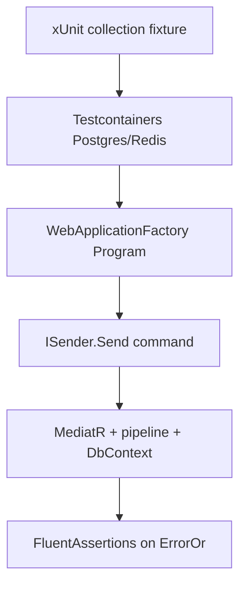

# تست‌نویسی در دژبان (بک‌اند و فرانت)

شناسهٔ کاتالوگ: `31-testing`.

این درس روی [07-modular-monolith](07-modular-monolith.md)، [08-cqrs-mediatr](08-cqrs-mediatr.md)، [09-ef-core-postgresql](09-ef-core-postgresql.md)، و [22-turborepo](22-turborepo.md) سوار است. هدف این است که بفهمید تست چیست، چه لایه‌هایی دارد، و در **همین مخزن** کدام ابزار واقعاً در سورس دیده می‌شود — نه فقط در `Directory.Packages.props` یا `package.json`.

**محدودیت این فاز:** اپ، `dotnet test`، Playwright، Vitest، Docker، و Testcontainers اجرا نشدند. هیچ تستی pass یا fail اعلام نمی‌شود. آنچه از کد خوانده می‌شود «وجود و شکل تست» است؛ آنچه فقط با اجرا معلوم می‌شود در بخش «Runtime verification pending» جدا شده است.

## هدف یادگیری

بعد از این درس باید بتوانید:

1. بگویید تست چرا ریسک رگرسیون را کم می‌کند.
2. unit، integration، architecture، و end-to-end را از هم جدا کنید.
3. نقش xUnit، FluentAssertions، Testcontainers، NetArchTest، Playwright، و Vitest را در این مخزن با شاهد بگویید.
4. یک تست واقعی را با Arrange / Act / Assert بخوانید.
5. فرق «تست نوشته شده»، «ابزار نصب/پیکربندی شده»، و «تست در CI اجرا و سبز شده» را بشناسید.

---

## 1. چرا تست می‌نویسیم؟

وقتی کد عوض می‌شود، سه خطر رایج است:

- رفتار درست قبلی بی‌صدا بشکند (رگرسیون).
- فرض معماری (مثلاً Domain به Infrastructure وابسته نباشد) فقط در حرف بماند.
- مسیر UI تا API فقط دستی و دیر کشف شود.

تست یک **قرارداد قابل تکرار** روی رفتار است: ورودی مشخص، عمل مشخص، انتظار مشخص. تست جای review انسانی را نمی‌گیرد؛ ولی هزینهٔ کشف زودهنگام باگ را پایین می‌آورد.

مثال سادهٔ آموزشی (نه کد مخزن):

```csharp
// illustrative — نه فایل مخزن
[Fact]
public void Add_TwoAndThree_ReturnsFive()
{
    var calc = new Calculator();
    calc.Add(2, 3).Should().Be(5);
}
```

اگر فردا `Add` را اشتباه عوض کنید، این تست باید قرمز شود — **به شرطی که واقعاً اجرا شود**. وجود فایل تست به‌تنهایی ضمانت اجرا یا سبز بودن نیست.

---

## 2. چهار لایهٔ رایج تست

| لایه | چه چیزی را می‌سنجد | وابستگی خارجی | سرعت تقریبی | نمونهٔ شاهد در این مخزن |
|---|---|---|---|---|
| Unit | یک واحد منطق، معمولاً بدون IO واقعی | mock/fake/in-memory یا هیچ | سریع | `BlackListScheduleTests`، `RelayOpenPolicyTests`، handlerهای RequestTracker با EF InMemory |
| Integration | چند جزء واقعی کنار هم (مثلاً handler + DB) | اغلب DB/Redis واقعی یا کانتینری | کندتر | `Visitors.IntegrationTests` با Testcontainers + `WebApplicationFactory`؛ `InventoryPostgresFixture` |
| Architecture | قوانین وابستگی اسمبلی/لایه، نه رفتار دامنه | reflection روی اسمبلی | معمولاً سریع | `LayerTests`، `ModuleTests` با NetArchTest |
| End-to-end (E2E) | مرورگر واقعی روی UI و اغلب backend زنده | مرورگر، URL، دادهٔ محیط | کند و شکننده | Playwright در `apps/main` و `apps/dejban` |

سوءبرداشت رایج: هر فایلی که نامش `*Tests` است لزوماً unit نیست. نام پروژه راهنماست؛ شکل Arrange و وابستگی‌ها تعیین‌کننده‌اند.

---

## 3. جدول ابزارها — ادعای کاتالوگ در برابر شاهد مخزن

نسخه‌های بک‌اند از `Directory.Packages.props`؛ فرانت از `package.json` ریشه / اپ‌ها.

| ابزار | نسخهٔ اعلام‌شده | شاهد پیکربندی | شاهد استفاده در سورس تست | جمع‌بندی |
|---|---|---|---|---|
| xUnit | `2.9.3` (+ runner `3.1.5`) | `PackageReference` در پروژه‌های `*Tests`؛ `Using Include="Xunit"` | `[Fact]` / `[Theory]` در ده‌ها فایل | **استفادهٔ واقعی** به‌عنوان runner .NET |
| FluentAssertions | `8.8.0` | همان csprojها | `.Should().Be…`، `ShouldBeSuccessful` روی نتیجهٔ NetArchTest | **استفادهٔ واقعی** برای assert خوانا |
| Testcontainers (PostgreSql / Redis) | `4.9.0` | پکیج مرکزی + csproj Integration | `PostgreSqlBuilder` / `RedisBuilder` در factoryها و fixtureها | **پیکربندی + کد fixture واقعی**؛ اجرای کانتینر در این فاز انجام نشد |
| NetArchTest.Rules | `1.3.2` | ArchitectureTests csproj | `Types.InAssembly(…).Should().NotHaveDependencyOn…` | **استفادهٔ واقعی** برای قوانین لایه/ماژول |
| Microsoft.NET.Test.Sdk | `18.0.1` | csproj تست | زیرساخت VSTest برای runner | وابستگی لازم runner |
| Microsoft.AspNetCore.Mvc.Testing | `10.0.0` | پکیج مرکزی | `WebApplicationFactory<Program>` در Integration Visitors/Dejban | host تست integration |
| Bogus | `35.6.5` | Unit/Integration Visitors و … | `Faker` برای دادهٔ ساختگی | دادهٔ تست، نه assert |
| coverlet.collector | `6.0.4` | چند csproj تست | فقط PackageReference | **جمع‌آوری coverage در زمان اجرای تست**؛ خود اجرا نشد |
| Playwright (`@playwright/test`) | `^1.61.0` | ریشه + `apps/main` + `apps/dejban`؛ `playwright.config.ts` | ده‌ها `*.spec.ts` smoke/e2e/regression | **E2E پیکربندی‌شده با spec واقعی**؛ اجرا نشد |
| Vitest | `^4.1.0` | ریشه؛ `apps/main` script `test:unit`: `vitest run`؛ task در `turbo.json` | در جستجوی `*.{test,spec}.{js,jsx,ts,tsx}` فایل unit جدا از Playwright یافت نشد؛ specهای موجود import از `@playwright/test` دارند | **وابستگی + اسکریپت**؛ شاهد meaningful unit suite در این فاز نبود |

ده پروژهٔ تست بک‌اند که `*Tests.csproj` دیده شد:

1. `Microservices/Dejban/test/Dejban.ArchitectureTests`
2. `Microservices/Dejban/test/Dejban.IntegrationTests`
3. `…/Visitors/Dejban.Modules.Visitors.ArchitectureTests`
4. `…/Visitors/Dejban.Modules.Visitors.UnitTests`
5. `…/Visitors/Dejban.Modules.Visitors.IntegrationTests`
6. `…/SecurityPatrols/…UnitTests` و `…IntegrationTests`
7. `…/Inventory/…IntegrationTests`
8. `Microservices/ACLServer/tests/ACLServer.UnitTests`
9. `Microservices/RequestTracker/tests/RequestTracker.UnitTests`

**NSubstitute / Moq** در `Directory.Packages.props` دیده نشد. در نمونهٔ RequestTracker به‌جای mock کتابخانه‌ای، `ApplicationDbContext` با `UseInMemoryDatabase` و `FakeTenantContext` ساخته می‌شود.

---

## 4. مفاهیم هسته در .NET

### 4.1 xUnit چه می‌آورد؟

xUnit یک **test framework** است: متدهای تست را کشف می‌کند، اجرا می‌کند، و نتیجه را به runner می‌دهد.

- `[Fact]`: یک سناریوی بدون پارامتر ورودی جدول‌مانند.
- `[Theory]` + `[MemberData]` / `[InlineData]`: چند ورودی، یک بدنهٔ تست.
- کلاس تست معمولاً برای هر اجرا instance تازه می‌سازد (مدل پیش‌فرض xUnit).

پروژه‌های تست با `<IsTestProject>true</IsTestProject>` و ارجاع به کد production علامت می‌خورند.

### 4.2 FluentAssertions چه می‌آورد؟

به‌جای `Assert.Equal(expected, actual)`، زنجیرهٔ خوانا می‌نویسید: `result.IsError.Should().BeTrue()`. پیام شکست معمولاً واضح‌تر است. در ArchitectureTests، extension محلی `ShouldBeSuccessful` روی `NetArchTest.Rules.TestResult` با FluentAssertions چک می‌کند `FailingTypes` خالی باشد:

`Microservices/Dejban/test/Dejban.ArchitectureTests/Abstractions/TestResultExtensions.cs`.

### 4.3 پروژهٔ تست چگونه به کد production وصل می‌شود؟

با `ProjectReference`. مثال Visitors UnitTests به Application و Domain ارجاع می‌دهد، نه به Infrastructure کامل host:

`Dejban.Modules.Visitors.UnitTests.csproj` → `…Application.csproj` و `…Domain.csproj`.

برای دیدن نوع‌های `internal` مثل `BlackListSchedule`، Application این را دارد:

```xml
<InternalsVisibleTo Include="Dejban.Modules.Visitors.UnitTests" />
```

بدون این خط، تست واحد نمی‌توانست `BlackListSchedule` را از بیرون اسمبلی ببیند. وضعیت: `verified`.

### 4.4 انزوا (isolation) و وابستگی‌ها

| وابستگی | اثر روی تست | الگوی دیده‌شده در مخزن |
|---|---|---|
| منطق خالص / Expression | انزوا بالا | `BlackListSchedule.IsActiveDuring`؛ `RelayOpenPolicy` |
| DbContext | نیاز به DB واقعی یا جایگزین | InMemory در RequestTracker؛ Postgres کانتینری در Inventory/Visitors Integration |
| ساعت سیستم | nondeterminism | تاریخ ثابت در Arrange (`BlockDay`، `Now`) |
| سرویس بیرونی / Redis | شکنندگی محیط | Redis container در `IntegrationTestWebAppFactory` |
| host کامل ASP.NET | نزدیک production، کند | `WebApplicationFactory<Program>` |

تستی که DB واقعی می‌زند، باگ SQL/migration را می‌تواند ببیند؛ ولی کندتر است و به Docker وابسته است. تست InMemory همان SQL واقعی Postgres را **تضمین نمی‌کند**.

### 4.5 Testcontainers چه می‌کند و چه تضمینی ندارد؟

**می‌کند (از روی کد):** قبل از تست، image Postgres/Redis را با API Testcontainers بالا می‌آورد، connection string می‌سازد، و معمولاً در `Dispose` خاموش می‌کند.

**تضمین نمی‌کند:**

- اینکه CI شما Docker دارد و تست‌ها آنجا اجرا می‌شوند (در این مخزن CI فرانت فقط `turbo run build` است؛ فایل `.gitlab-ci.yml` برای بک‌اند در ریشهٔ `dejban_backend_new` یافت نشد).
- اینکه image `postgres:latest` همیشه با نسخهٔ production یکی است (Inventory صریحاً `postgres:16-alpine` می‌گیرد؛ Visitors factory از `postgres:latest` استفاده می‌کند — تفاوت شاهدشده).
- اینکه تست کامنت‌شده یا `[Theory]` غیرفعال واقعاً سناریوی happy-path را پوشش می‌دهد.

### 4.6 NetArchTest چه را می‌تواند ثابت کند؟

قوانین **وابستگی compile-time بین اسمبلی‌ها/نوع‌ها** را، مثلاً Domain نباید به Infrastructure وابسته باشد. رفتار runtime، صحت business rule، یا کیفیت UI را نمی‌سنجد.

نکتهٔ مهم از درس 07 که اینجا هم شاهد است: در `Dejban.ArchitectureTests/.../ModuleTests.cs` آرایه‌های `otherModules` و `integrationEventsModules` **خالی**اند. پس تست «Visitors به ماژول دیگر وابسته نباشد» از نظر ساختاری اجرا می‌شود، ولی با لیست خالی، قدرت محدودکنندگی بین‌ماژولی‌اش ضعیف است. وضعیت ساختار: `verified`. نتیجهٔ سبز/قرمز: اجرا نشد.

---

## 5. مسیر اجرای ذهنی — بک‌اند (بدون اجرای واقعی)

### مسیر A — Unit روی منطق Expression

```text
xUnit کشف [Fact] در BlackListScheduleTests
  → Arrange: BlackList.Create(...) + بازهٔ visit
  → Act: BlackListSchedule.IsActiveDuring(...).Compile()(blackList)
  → Assert: FluentAssertions .Should().BeTrue/BeFalse
  → کد production: Visitors.Application/.../BlackListSchedule.cs
```

این تست IO ندارد. می‌توان از روی سورس فهمید چه قراردادی ادعا شده است. سبز بودن فقط با runner معلوم می‌شود.

### مسیر B — Architecture لایه Visitors

```text
[Fact] در LayerTests
  → NetArchTest Types.InAssembly(DomainAssembly)
  → Should().NotHaveDependencyOn(ApplicationAssembly.GetName().Name)
  → GetResult()
  → ShouldBeSuccessful()  // FailingTypes باید خالی باشد
```

ورودی تست، اسمبلی‌های بارگذاری‌شده در process تست است؛ خروجی، فهرست نوع‌های ناقض قانون.

### مسیر C — Integration Visitors با host + کانتینر

```text
IntegrationTestCollection = ICollectionFixture<IntegrationTestWebAppFactory>
  → InitializeAsync: StartAsync Postgres + Redis
  → ConfigureWebHost: env ConnectionStrings:Postgres / Redis
  → BaseIntegrationTest: CreateScope → ISender + VisitorsDbContext + HttpClient
  → CreateVisitorTests: Sender.Send(CreateVisitorCommand)
  → Assert روی ErrorOr (مثلاً Validation)
```

فایل‌ها:

- `…Visitors.IntegrationTests/Abstractions/IntegrationTestWebAppFactory.cs`
- `…/BaseIntegrationTest.cs`
- `…/Visitors/CreateVisitorTests.cs`

`Dejban.IntegrationTests` ریشه هم factory مشابه دارد، ولی سناریوی `CreateVisitorTests` آنجا **کاملاً کامنت** است. وضعیت: `verified` از روی سورس.



---

## 6. نمونه‌های منبع‌محور (بک‌اند)

### 6.1 Unit — `BlackListScheduleTests`

مسیر: `Microservices/Dejban/Modules/Visitors/Dejban.Modules.Visitors.UnitTests/Visitors/BlackListScheduleTests.cs`.

رفتار مورد ادعا: برای blacklist یک‌روزه، اگر بازهٔ بازدید بعد از آن روز شروع شود، `IsActiveDuring` باید false؛ اگر overlap داشته باشد، true.

Arrange / Act / Assert در تست اول:

1. Arrange: `TodayOnlyBlock()` با `BlockDay = 2026-09-23`؛ visit از 24 تا 25.
2. Act: `BlackListSchedule.IsActiveDuring(visitStart, visitEnd).Compile()` سپس فراخوانی روی blacklist.
3. Assert: `matches(blackList).Should().BeFalse()`.

وابستگی‌ها: واقعی روی Expression و entity دامنه؛ بدون DB. آنچه نمی‌بیند: ترجمهٔ همان Expression روی Postgres، یا handlerهای CreateVisit که آن را در `.Where(...)` مصرف می‌کنند — مگر جداگانه integration بنویسید.

`VisitorTests.cs` در همان پروژه تقریباً همهٔ `[Fact]`ها را **کامنت** کرده؛ پس نام فایل UnitTests به‌معنی پوشش Create/Update Visitor نیست. وضعیت: `verified`.

### 6.2 Unit — `RelayOpenPolicyTests` (ACL)

مسیر: `Microservices/ACLServer/tests/ACLServer.UnitTests/RelayOpenPolicyTests.cs`.

منطق خالص با ساعت ثابت `Now`. مثال: رویداد دیر `Stale` برمی‌گرداند؛ تأیید اپراتور همیشه اجازهٔ باز کردن می‌دهد (`Should().BeNull()` برای suppress reason). بدون host و بدون DB.

### 6.3 Unit با جایگزین DB — RequestTracker

مسیر نمونه: `…/RequestTracker.UnitTests/Commands/UpdateRequestTypeStepCommandHandlerTests.cs`.

- `TestDbContextFactory.Create` → `UseInMemoryDatabase`.
- `FakeTenantContext` با `IsSuperAdmin = true`.
- Act: `_handler.Handle(command, …)`.
- Assert: عنوان و assignee روی DbContext.

این به واحد «handler + persistence abstraction» نزدیک است، نه Postgres واقعی. تفاوت با Testcontainers را در مصاحبه باید بتوانید بگویید.

### 6.4 Architecture — `LayerTests`

مسیر: `…Visitors.ArchitectureTests/Layers/LayerTests.cs`.

چند `[Fact]` جدا: Domain↛Application، Domain↛Infrastructure، Application↛Infrastructure، Application↛Presentation، Presentation↛Infrastructure.

آنچه fail می‌کند اگر کسی `using`/ProjectReference اشتباه به لایهٔ ممنوع بدهد. آنچه fail نمی‌کند: handler اشتباه، SQL بد، UI شکسته.

### 6.5 Integration — validation مسیر CreateVisitor

مسیر: `…Visitors.IntegrationTests/Visitors/CreateVisitorTests.cs`.

- `[Theory]` + `InvalidCommands` (نام یا نام‌خانوادگی خالی) **فعال** است: انتظار `result.IsError` و `ErrorType.Validation`.
- Theory مربوط به `ValidCommands` / مسیر موفق **کامنت** است با TODO ساخت VisitorType.

پس از روی سورس می‌توان گفت: پوشش validation منفی ادعا شده؛ happy-path در این فایل فعلاً غیرفعال است. نتیجهٔ اجرا: pending.

### 6.6 Integration fixture انبار

`InventoryPostgresFixture` فقط Postgres (بدون Redis در این fixture)، `MigrateAsync`، و `InventoryDbContext` با Npgsql می‌سازد. الگوی integration نزدیک‌تر به persistence ماژول است تا host کامل Visitors.

---

## 7. فرانت‌اند: Playwright و Vitest

### 7.1 اسکریپت‌ها و turbo

ریشهٔ `dejban_frontend_new/package.json`:

- `test:e2e` → `turbo run test:e2e`
- `test:unit` → `turbo run test:unit`

`turbo.json`: هر دو task با `cache: false`؛ e2e با `passThroughEnv` برای `CI` و `PLAYWRIGHT_*`.

`apps/main/package.json`: `test:e2e` = `playwright test`؛ `test:unit` = `vitest run`.  
`apps/dejban/package.json`: `test:e2e` دارد؛ در جستجوی این فاز `test:unit` فقط روی `apps/main` دیده شد.

### 7.2 Playwright — پیکربندی و نمونه

`apps/main/playwright.config.ts`: `testDir: './tests'`؛ پروژه‌های `smoke-public`، `smoke-auth`، `regression`، `e2e`؛ در CI: `forbidOnly`، `retries: 2`، `workers: 1`.

نمونه: `apps/main/tests/smoke/public/specs/Login.spec.ts`

- صفحه login لود شود و URL شامل `sign-in` باشد.
- login معتبر → URL خانه و heading «دژبان».
- credentials نامعتبر → پیام `Login failed`.
- فیلد خالی → validation UI.

این تست‌ها به **مرورگر + baseURL محیط** وابسته‌اند. از روی سورس می‌فهمید چه assertionهایی نوشته شده؛ سبز بودن به زنده بودن اپ و دادهٔ `loginData` بستگی دارد — اجرا نشد.

در `apps/dejban/tests/e2e/` سناریوهای Major، Personnel، Door و غیره با همان الگوی Playwright دیده شد.

### 7.3 Vitest

Vitest در ریشه به‌عنوان dependency هست و script `test:unit` روی main تعریف شده است. در این فاز:

- فایل پیکربندی جدا با نام `vitest.config.*` زیر `apps/main` یافت نشد.
- فایل‌های `*.test.*` / unit جدا از پوشهٔ Playwright یافت نشد؛ specهای موجود Playwrightاند.

پس Vitest اینجا بیشتر «آماده در tooling» است تا «suite واحد غنی». ادعای پوشش unit فرانت فقط از روی نام پکیج نادرست است.

---

## 8. CI و اجرای تست

### فرانت — `.gitlab-ci.yml`

مراحل دیده‌شده: `deploy` → SSH → `npm ci` → `npx turbo run build --concurrency=1` → pm2 start/restart.

**هیچ `test:e2e`، `test:unit`، یا `playwright` در script CI خوانده‌شده نیست.** پس از روی CI فعلی نمی‌توان نتیجه گرفت تست‌ها روی هر push سبز شده‌اند؛ فقط build deploy می‌شود. وضعیت: `verified` برای نبود گام تست؛ نتیجهٔ تست‌ها: N/A در این pipeline.

### بک‌اند

فایل `.gitlab-ci.yml` در ریشهٔ `dejban_backend_new` در این فاز یافت نشد. ادعای «pipeline بک‌اند همیشه `dotnet test` می‌زند» بدون شاهد جدا پشتیبانی نمی‌شود.

### مسیر اسکریپت محلی (پیکربندی، نه اجرای این فاز)

```text
npm run test:e2e
  → turbo run test:e2e
    → در workspaceهایی که script دارند: playwright test

npm run test:unit
  → turbo run test:unit
    → apps/main: vitest run   (suite meaningful در این فاز دیده نشد)
```

برای بک‌اند، مسیر متعارف صنعت `dotnet test` روی solution/پروژه است؛ فراخوانی‌اش در CI این مخزن در این فاز اثبات نشد.

---

## 9. چه چیزی واقعاً پوشش داده شده به‌نظر می‌رسد؟ (فقط از سورس)

پوشش نسبتاً فعال (متدهای `[Fact]`/`[Theory]` غیرفعال‌نشده در فایل‌های خوانده‌شده):

- قوانین لایه Visitors و مجموعهٔ ArchitectureTests مرتبط.
- منطق blacklist schedule و سیاست رله ACL و engineهای SecurityPatrols / handlerهای RequestTracker (از روی تعداد Factها و خواندن نمونه‌ها).
- بخشی از validation منفی CreateVisitor در integration Visitors.
- E2E/smoke Playwright برای login و برخی CRUDهای dejban.

محدودیت آشکار از روی سورس:

- `VisitorTests` و happy-path CreateVisitor (و تست ریشهٔ `Dejban.IntegrationTests`) کامنت یا خالی از سناریوی فعال.
- `ModuleTests` با آرایهٔ ماژول خالی.
- Vitest بدون suite واحد معنادار در جستجوی این فاز.
- CI فرانت بدون اجرای تست.
- coverlet فقط به‌صورت collector اعلام شده؛ گزارش coverage تولید/خوانده نشد.

**تفاوت سه سطح ادعا:**

| سطح | معنی |
|---|---|
| تست وجود دارد | فایل/`[Fact]` در سورس هست |
| تست پیکربندی شده | csproj، Playwright config، turbo task، Docker برای Testcontainers |
| تست pass شده | فقط با اجرای runner + محیط؛ در این فاز **اعلام نمی‌شود** |

---

## 10. سوءبرداشت‌ها و دام‌های عملی

1. **«پکیج در Directory.Packages یعنی همه جا تست می‌نویسیم»** — فقط نسخه را مرکزی می‌کند؛ پروژه‌های بدون ارجاع تست ندارند.
2. **«Integration با Testcontainers = عین production»** — image، migrate، و seed ممکن است فرق کند؛ Redis/Postgres بالا آمدن ≠ دادهٔ واقعی مشتری.
3. **«Architecture test جایگزین unit دامنه است»** — فقط گراف وابستگی را نگه می‌دارد.
4. **«InMemory EF همان Postgres است»** — قابلیت‌ها و SQL فرق دارند.
5. **«CI سبز یعنی تست‌ها سبزند»** — اینجا CI فرانت اساساً build است.
6. **«فایل `*Tests` یعنی پوشش»** — ممکن است همه چیز کامنت باشد (`VisitorTests`).
7. **«Playwright همان unit فرانت است»** — E2E مرورگر است؛ Vitest برای unit جدا تعریف شده ولی suite غنی دیده نشد.
8. **«کامنت کردن Theory موفق بی‌ضرر است»** — مسیر شاد validation منفی را بی‌رقیب می‌گذارد؛ رگرسیون create موفق ممکن است دیر دیده شود.

---

## 11. حقایق منبع‌محور در برابر استنباط در برابر Runtime pending

### Source-verified

- نسخه‌ها و ارجاع پکیج‌های تست در `Directory.Packages.props` و csprojها.
- ده `*Tests.csproj` فهرست‌شده.
- محتوای نمونه‌های `BlackListScheduleTests`، `LayerTests`، `ModuleTests`، `CreateVisitorTests` (Visitors)، `IntegrationTestWebAppFactory`، `RelayOpenPolicyTests`، `UpdateRequestTypeStepCommandHandlerTests`، `InventoryPostgresFixture`.
- `InternalsVisibleTo` برای Unit/Integration Visitors.
- Playwright config و specهای login؛ اسکریپت‌های turbo؛ نبود گام تست در `.gitlab-ci.yml` فرانت.
- نبود `.gitlab-ci.yml` در ریشهٔ بک‌اند در این جستجو.
- وابستگی Vitest + script بدون یافتن suite واحد جدا.

### Reasoned inferences

- تیم برای Visitors بیشتر روی architecture + بخشی از integration validation سرمایه‌گذاری کرده تا unit موجودیت Visitor (به‌خاطر کامنت بودن VisitorTests).
- RequestTracker آگاهانه InMemory را برای سرعت unit/handler انتخاب کرده؛ Inventory آگاهانه Postgres کانتینری برای نزدیک‌شدن به SQL واقعی.
- خالی بودن آرایهٔ `ModuleTests` یعنی قانون بین‌ماژولی هنوز سختگیرانه wire نشده (هم‌راستا با درس 07).

### Runtime verification pending

- هر نتیجهٔ pass/fail برای `dotnet test`، Playwright، Vitest.
- توانایی ماشین CI/لوکال برای کشیدن imageهای Testcontainers.
- زمان و پایداری suiteهای E2e در برابر محیط واقعی.
- خروجی پوشش coverlet.
- هم‌ترازی رفتاری InMemory در برابر Postgres برای سناریوهای RequestTracker.

---

## 12. چک‌پوینت‌های یادگیری عملی

- [ ] یک `[Fact]` در `BlackListScheduleTests` را خط‌به‌خط برای همکار توضیح می‌دهم.
- [ ] می‌توانم بگویم چرا `LayerTests` با تغییر یک `ProjectReference` ممکن است قرمز شود ولی UI را نبیند.
- [ ] فرق `WebApplicationFactory` + Testcontainers با `UseInMemoryDatabase` را با مثال مخزن می‌گویم.
- [ ] از روی `CreateVisitorTests` می‌گویم کدام Theory فعال و کدام کامنت است.
- [ ] مسیر `npm run test:e2e` تا Playwright را از turbo بلدم، بدون ادعای سبز بودن.
- [ ] می‌دانم CI فعلی فرانت تست را اجرا نمی‌کند.
- [ ] Vitest را از Playwright جدا می‌کنم و وضعیت شاهد suite را صادقانه می‌گویم.

---

## 13. ده سؤال مصاحبه

### 1. تفاوت unit و integration را با مثال همین مخزن بگویید.

Unit مثل `BlackListScheduleTests` یا `RelayOpenPolicyTests` منطق را بدون Postgres واقعی می‌سنجد. Integration مثل `Visitors.IntegrationTests` با `WebApplicationFactory` و Testcontainers چند لایهٔ واقعی (host، MediatR، connection) را درگیر می‌کند.

**Follow-up:** پس چرا RequestTracker با وجود نام UnitTests از DbContext استفاده می‌کند؟  
چون وابستگی persistence با **جایگزین** InMemory ارضا شده؛ هنوز Postgres کانتینری نیست. مرز نام‌گذاری پروژه‌ها کامل نیست؛ به شکل fixture نگاه کنید.

### 2. انزوای تست یعنی چه و ساعت سیستم چرا خطرناک است؟

انزوا یعنی نتیجهٔ تست به حالت مشترک flaky (زمان دیوار، شبکه، ترتیب اجرا، دادهٔ باقی‌مانده) وابسته نباشد. اگر `DateTime.Now` داخل production بدون تزریق باشد، تست ممکن است فقط در ساعات خاص بشکند. در نمونه‌ها تاریخ‌ها ثابت Arrange شده‌اند (`BlockDay`، `Now`).

### 3. FluentAssertions چه ارزشی غیر از «زیبایی» دارد؟

پیام شکست ساخت‌یافته و assertهای دامنه (مثل `ContainSingle`) خواندن intent را آسان می‌کند. در ArchitectureTests، پل `ShouldBeSuccessful` نتیجهٔ NetArchTest را به همان زبان assert وصل می‌کند.

### 4. Testcontainers چه چیزی را ثابت نمی‌کند حتی اگر fixture درست باشد؟

ثابت نمی‌کند CI شما Docker دارد، image با production یکی است، یا سناریوهای کامنت‌شده پوشش دارند. فقط زیرساخت «DB/Redis واقعی در کانتینر برای این process تست» را در کد فراهم می‌کند.

### 5. NetArchTest چه نوع باگی را می‌گیرد و چه نوعی را نه؟

می‌گیرد: Domain که به Infrastructure reference بدهد. نمی‌گیرد: فرمول اشتباه blacklist، endpoint 500، یا login UI.

**Follow-up:** مشکل `ModuleTests` با آرایه خالی چیست؟  
قانون «به ماژول دیگر وابسته نباش» بدون فهرست ماژول‌های دیگر practically چیزی را منع نمی‌کند.

### 6. اگر فقط Playwright سبز باشد، چه چیزی را هنوز نمی‌دانید؟

نمی‌دانید لایهٔ دامنه یا قوانین معماری جداگانه پاس شده‌اند؛ E2E ممکن است با دادهٔ محیط یا UI selector شکننده باشد و منطق خالص را نقطه‌ای پوشش ندهد. برعکس، unit سبز هم به‌تنهایی UX را ثابت نمی‌کند.

### 7. از وجود script `test:unit`: `vitest run` چه نتیجه‌ای می‌توان گرفت؟

می‌توان گفت tooling و task turbo برای unit فرانت **پیکربندی** شده. نمی‌توان نتیجه گرفت suite واحد غنی وجود دارد یا در CI اجرا می‌شود — در این فاز spec واحد جدا یافت نشد و CI تست نمی‌زند.

### 8. `InternalsVisibleTo` در تست چه نقشی دارد؟

اجازه می‌دهد اسمبلی تست به اعضای `internal` مثل `BlackListSchedule` دسترسی داشته باشد بدون public کردن API فقط برای تست. شاهد در csproj Application Visitors.

### 9. از نبود گام تست در GitLab CI فرانت چه چیزی می‌توان و نمی‌توان نتیجه گرفت؟

می‌توان: merge به `master` در این workflow لزوماً اجرای Playwright/Vitest را اجبار نمی‌کند؛ تمرکز روی build و pm2 است. نمی‌توان: «توسعه‌دهنده‌ها هرگز تست را محلی اجرا نمی‌کنند» — آن خارج از این فایل است.

### 10. یک تست کامنت‌شده در مخزن چه سیگنالی به مصاحبه‌گر می‌دهد؟

سیگنال قصد یا پوشش تاریخی، نه پوشش فعلی. `VisitorTests` و Theory موفق CreateVisitor نشان می‌دهند مسیر زمانی مدنظر بوده؛ وضعیت امروز از روی کد فعال قضاوت می‌شود، نه نام پوشه.

**Follow-up:** چطور بین «تست پیکربندی‌شده» و «تست pass‌شده» در رزومه/گزارش حرف بزنید؟  
پیکربندی = وجود پروژه، پکیج، config، اسکریپت. Pass = خروجی runner در محیط مشخص با تاریخ/لینک CI. بدون دومی، فقط اولی را ادعا کنید.

---

## 14. خلاصه

در این مخزن اکوسیستم تست بک‌اند حول **xUnit + FluentAssertions** می‌چرخد، با **NetArchTest** برای مرز ماژول/لایه، و **Testcontainers + WebApplicationFactory** برای بخشی از integration. فرانت **Playwright** را با spec و config جدی دارد؛ **Vitest** بیشتر در سطح dependency/script دیده شد. CI فرانت فعلی تست را اجرا نمی‌کند. هیچ نتیجه‌ای از اجرای تست در این فاز ثبت نشد.

## 15. منابع

- `Directory.Packages.props` (نسخه‌های تست)
- `Microservices/Dejban/Modules/Visitors/Dejban.Modules.Visitors.UnitTests/**`
- `Microservices/Dejban/Modules/Visitors/Dejban.Modules.Visitors.ArchitectureTests/**`
- `Microservices/Dejban/Modules/Visitors/Dejban.Modules.Visitors.IntegrationTests/**`
- `Microservices/Dejban/test/Dejban.ArchitectureTests/**`
- `Microservices/Dejban/test/Dejban.IntegrationTests/**`
- `Microservices/ACLServer/tests/ACLServer.UnitTests/RelayOpenPolicyTests.cs`
- `Microservices/RequestTracker/tests/RequestTracker.UnitTests/**`
- `Microservices/Dejban/Modules/Inventory/.../InventoryPostgresFixture.cs`
- `dejban_frontend_new/package.json`، `turbo.json`، `.gitlab-ci.yml`
- `dejban_frontend_new/apps/main/playwright.config.ts`، `apps/main/tests/**`
- `dejban_frontend_new/apps/dejban/tests/**`
- درس‌های `07-modular-monolith.md`، `08-cqrs-mediatr.md`، `22-turborepo.md`
