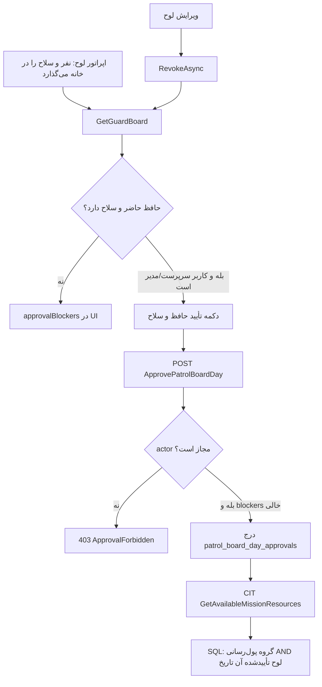

# تأیید روزانه محافظ و سلاح روی لوح حفاظت

این سند توضیح می‌دهد **اگر خودت بخواهی همین قابلیت را از صفر در دژبان بسازی، از کجا شروع کنی، چه تصمیمی بگیری، و کد را چطور بنویسی.** متن بر اساس سورس فعلی مخزن است، نه یک طرح خیالی.

صفحهٔ محصول: `/dejban/dashboard/arrangement/guard-plaque`  
نام کسب‌وکار: لوح حفاظت / لوح نگهبانی  
ماژول مالک: `SecurityPatrols`  
مصرف‌کننده: `CashLogistics` (عملیات پول‌رسانی)

شاهدهای اصلی بعد از پیاده‌سازی:

- `Microservices/Dejban/Modules/SecurityPatrols/Dejban.Modules.SecurityPatrols.Domain/Patrols/PatrolBoardDayApproval.cs`
- `.../Application/Patrols/GuardBoard/ApprovePatrolBoardDayCommandHandler.cs`
- `.../Application/Patrols/GuardBoard/DailyProtectorApproval.cs`
- `.../Presentation/Patrols/GuardBoardEndpoints.cs` کلاس `ApprovePatrolBoardDay`
- `Microservices/Dejban/Modules/CashLogistics/.../CashMissions/MissionResourceCatalog.cs`
- `apps/dejban/src/sections/guard-plaque/guard-board-view.jsx`

---


## 1. مسئله چیست؟ (قبل از هر خط کد)

لوح حفاظت جدولی است که برای **یک شیفت + یک تاریخ** نشان می‌دهد در هر **نوبت کاری** (`PatrolShiftWorkPeriod`) چه کسی در کدام محل ایستاده و چه تجهیزی دستش است.

نیاز محصول این بود:

1. هر روز و هر نوبت باید حافظ (محافظ) و سلاح داشته باشد.
2. سرپرست شیفت یا مدیر شیفت باید همان تخصیص را **تأیید** کند.
3. فقط بعد از تأیید، آن حافظ و آن سلاح در **لیست منابع عملیات پول‌رسانی** ظاهر شوند.
4. منبع حقیقت فقط **لوح تأییدشده** باشد، نه «هر کسی حاضر است» و نه «همهٔ اسلحه‌های اسلحه‌خانه».

اگر این سه جمله را نفهمی، کد را هم اشتباه می‌نویسی. تأیید یک دکمهٔ تزئینی نیست؛ یک **قفل انتشار** است بین انتظامات و پول‌رسانی.

---


## 2. استراتژی کار؛ خودت چطور کشف می‌کنی

قبل از طراحی جدول جدید، همین مخزن را مثل یک کارآگاه می‌خوانی. ترتیب درست این است.

### 2.1 صفحه را پیدا کن

در فرانت‌اند جستجو کن: `guard-plaque` یا `لوح`. مسیر صفحه به `GuardBoardView` می‌رسد.

```
apps/dejban/src/app/dashboard/arrangement/guard-plaque/page.jsx
  → GuardPlaqueListView / GuardBoardView
  → useGuardBoard({ shiftId, boardDate })
  → GET /Patrols/GetGuardBoard
```

این به تو می‌گوید API از قبل وجود دارد و UI خانه‌های جدول را از `assignments` و ستون نوبت را از `periods` می‌سازد.

### 2.2 مدل لوح را پیدا کن

موجودیت اصلی `PatrolBoard` است:

- `PersonnelId` = حافظ
- `ShiftId` + `ShiftWorkPeriodId` + `BoardDate` = کدام روز و نوبت
- `IsPresent` = حاضر / غایب
- `Equipments` = مجموعهٔ `SecurityEquipment` (سلاح/تجهیز روی لوح)

شاهد: `.../Domain/Patrols/PatrolBoard.cs`

### 2.3 ببین تأیید از قبل هست یا نه

در لوح، حاضر/غایب و سرپرست روز (`SetDayChiefs`) هست. دکمهٔ تأیید روزانه نیست. پس باید **وضعیت جدید** اضافه کنی، نه اینکه حاضر بودن را معادل تأیید فرض کنی.

### 2.4 ببین پول‌رسانی منابع را از کجا می‌آورد

`GetAvailableMissionResources` در `CashMissionReader.AvailableAsync` بر اساس `resourceType` به `IMissionResourceCatalog` می‌رود.

قبل از این فیچر (رفتار قدیمی، از روی همان فایل قابل بازسازی است):

- `guard`: عضو گروه با `is_for_cash_mission` به‌علاوهٔ ردیف `cash_logistics.cash_guard_presences` (همگام از حضور لوح، **بدون تأیید**)
- `weapon`: تقریباً همهٔ `armory.weapons` سالم
- `equipment`: همهٔ `security_patrols.security_equipments` با `is_for_cash_mission`

این دقیقاً همان شکاف محصول است.

### 2.5 نقش سرپرست را پیدا کن

دو مفهوم جدا در همین ماژول هست. قاطی‌شان نکن.


| نقش در تسک                     | در کد                                                                                   | جدول / موجودیت                  |
| ------------------------------ | --------------------------------------------------------------------------------------- | ------------------------------- |
| سرپرست / جانشین نوبت در آن روز | `ShiftSupervisorAndDeputy` با `IsSupervisor` / `IsDeputy` و بازهٔ `StartDate`/`EndDate` | `shift_supervisor_and_deputies` |
| مدیر شیفت                      | `PatrolShiftPersonnel.IsSupervisor` روی خود شیفت                                        | `patrol_shift_personnels`       |


شناسهٔ کاربر لاگین‌شده در خیلی از handlerهای انتظامات همان `PersonnelId` است: `HttpContext.User.GetUserId()`.

شاهد الگو: `CreatePatrolEventCommandHandler` و `GetPatrolBoardsQueryHandler`.

### 2.6 قانون migration این مخزن

تغییر schema را در entity و `IEntityTypeConfiguration` می‌نویسی. کلاس `Migration` را **داخل ریپو commit نمی‌کنی**. روی سرور فرآیند `migrationesho` جدول را می‌سازد. اگر لوکال تست می‌کنی، migration موقت بساز و قبل از commit پاکش کن.

---


## 3. تصمیم طراحی (اینجا بیشتر کار فکری است تا تایپ)


### 3.1 دانهٔ تأیید چیست؟

گزینه‌ها:

1. یک تأیید برای کل روز شیفت
2. یک تأیید برای هر نوبت (`ShiftId` + `ShiftWorkPeriodId` + `BoardDate`)
3. یک تأیید برای هر ردیف `PatrolBoard` (هر نفر)

تسک می‌گوید «هر روز و هر شیفت/نوبت». در UI هر ستون نوبت سرپرست جدا دارد. پس گزینهٔ 2 درست است: **تأیید در سطح نوبت آن روز**.

اگر سطح نفر باشد، سرپرست باید ده بار کلیک کند. اگر سطح کل روز باشد، نوبت صبح تأیید می‌شود در حالی که عصر هنوز سلاح ندارد.

### 3.2 موجودیت جدا، نه فلگ روی `PatrolBoard`

چرا جدول جدا `PatrolBoardDayApproval`؟

- تأیید یک **رخداد مدیریتی** است (چه کسی، چه زمانی)، نه ویژگی یک خانهٔ جدول.
- اگر سه نفر در یک نوبت باشند، یک تأیید برای هر سه کافی است.
- با ویرایش هر خانه باید کل تأیید آن نوبت باطل شود؛ یک ردیف را پاک کردن ساده‌تر از به‌روز کردن چند فلگ است.

یونیک بودن:

```
(ShiftId, ShiftWorkPeriodId, BoardDate) unique
```

یعنی برای یک نوبت در یک روز حداکثر یک تأیید فعال.

### 3.3 سلاح روی لوح کدام موجودیت است؟

لوح `SecurityEquipment` می‌گذارد، نه مستقیماً `armory.weapons`.

پول‌رسانی دو نوع منبع دارد:

- `MissionResourceType.Weapon` → جدول `armory.weapons`
- `MissionResourceType.SecurityEquipment` → `security_equipments` با `IsForCashMission`

استراتژی پیاده‌سازی فعلی:

- برای **تأیید لوح**: هر حافظ حاضر باید حداقل یک تجهیز روی ردیفش داشته باشد. فلگ `IsForCashMission` برای تأیید لازم نیست؛ وگرنه لوح گشت معمولی غیرقابل تأیید می‌شود.
- برای **لیست CIT**: فقط تجهیز/سلاحی که روی لوح **تأییدشده و حاضر** آن تاریخ است. اتصال اسلحهٔ اسلحه‌خانه با `eq.id = weapon.id` یا برابر بودن `serial_number`.

این یک inference معقول از مدل موجود است. اگر در دادهٔ واقعی serialها هیچ‌وقت یکی نباشند، لیست `weapon` خالی می‌ماند و لیست `equipment` باید کار کند.

### 3.4 CIT چطور لوح را ببیند؟

ماژول‌ها schema جدا دارند. `CashLogistics` نباید `DbContext` انتظامات را inject کند. الگوی موجود همان **SQL خام با Dapper** روی connection مشترک Postgres است (`MissionResourceCatalog`).

گزینهٔ event:

- قبلاً `GuardAttendanceChanged` حضور را به `cash_guard_presences` می‌فرستاد.
- می‌شد `IsApproved` روی همان جدول گذاشت و با integration event همگام کرد.

انتخاب فعلی: **خواندن مستقیم** `patrol_boards` + `patrol_board_day_approvals` در لحظهٔ لیست منابع. منبع حقیقت یک جا می‌ماند و نیازی به consumer جدید نیست. هزینه: کوئری بین schema و وابسته بودن به وجود جدول جدید.

### 3.5 ابطال تأیید

هر تغییری که ترکیب نفر/سلاح آن نوبت را عوض کند باید تأیید را پاک کند. در کد فعلی:


| عمل                   | handler                             | ابطال                                |
| --------------------- | ----------------------------------- | ------------------------------------ |
| افزودن خانه           | `CreatePatrolBoardCommandHandler`   | `RevokeAsync(shift, date, period)`   |
| ویرایش حضور/تجهیز     | `UpdatePatrolBoardCommandHandler`   | همان                                 |
| حذف ردیف              | `RemovePatrolBoardCommandHandler`   | همان                                 |
| پر کردن خانه‌های خالی | `FillEmptyBoardCellsCommandHandler` | برای هر نوبت/روزی که ردیف جدید ساخته |


`CopyPatrolBoardDay` روز خالی را کپی می‌کند و تأیید مبدأ را با خودش نمی‌آورد؛ روز جدید تأییدنشده است. این رفتار با «باید دوباره تأیید شود» می‌خواند.

---


## 4. مدل ذهنی جریان




این نمودار با handlerها و SQL فعلی می‌خواند. اجرای زندهٔ مرورگر در زمان نوشتن این سند انجام نشده است.

---


## 5. لایه Domain: موجودیت تأیید

فایل: `PatrolBoardDayApproval.cs`

الگو مثل بقیهٔ entityهای انتظامات است: سازندهٔ خصوصی برای EF، factory به نام `Create`.

```csharp
public sealed class PatrolBoardDayApproval : Entity
{
    private PatrolBoardDayApproval() { }

    public Guid Id { get; private set; }
    public Guid ShiftId { get; private set; }
    public Guid ShiftWorkPeriodId { get; private set; }
    public DateTime BoardDate { get; private set; }
    public Guid ApprovedByPersonnelId { get; private set; }
    public DateTime ApprovedAt { get; private set; }
    // navigationها برای FK و Include
}
```

خط‌به‌خط تصمیم‌ها:

- `BoardDate` از نوع `DateTime` است چون `PatrolBoard.BoardDate` هم `DateTime` است. مقدار را با `ShiftPool.Stamp(DateOnly)` می‌سازی تا نیمه‌شب UTC شود و با فیلتر `.Date` در کوئری یکی بماند.
- `ApprovedAt = DateTime.UtcNow` داخل factory؛ کلاینت ساعت را نمی‌فرستد.
- setterها private هستند تا کسی از handler مستقیم فیلد را عوض نکند. ابطال یعنی **حذف ردیف**، نه فلگ `IsRevoked`.

اینترفیس مخزن:

```csharp
public interface IPatrolBoardDayApprovalRepository
{
    IQueryable<PatrolBoardDayApproval> GetQueryable();
    void Insert(PatrolBoardDayApproval approval);
    void Remove(PatrolBoardDayApproval approval);
    Task RevokeAsync(Guid shiftId, DateTime boardDate, Guid? shiftWorkPeriodId, CancellationToken cancellationToken = default);
}
```

`RevokeAsync` ردیف‌ها را `RemoveRange` می‌کند، `ExecuteDelete` نیست، تا با `SaveChanges` همان تراکنش یکی شود. اگر `ExecuteDelete` را قبل از `SaveChanges` بزنی، ابطال فوری به دیتابیس می‌رود و ممکن است با rollback بقیهٔ کار نخواند.

خطاهای دامنه در `PatrolBoardErrors`:

- `ApprovalForbidden` → فقط سرپرست/جانشین همان نوبت در آن روز، یا مدیر شیفت
- `ApprovalIncomplete` → حافظ حاضر بدون سلاح، یا هیچ حاضر ندارد

---


## 6. لایه Infrastructure: جدول و DI


### 6.1 Configuration

فایل: `PatrolBoardDayApprovalConfiguration.cs`

```csharp
builder.ToTable("patrol_board_day_approvals");
builder.HasIndex(row => new { row.ShiftId, row.ShiftWorkPeriodId, row.BoardDate }).IsUnique();
```

`UseSnakeCaseNamingConvention` در `SecurityPatrolsModule` ستون‌ها را `shift_id` و غیره می‌کند. CIT با همین نام‌های snake_case کوئری می‌زند. اگر convention را فراموش کنی، SQL دپر می‌شکند.

`OnDelete(Restrict)` یعنی حذف شیفت، تأیید یتیم نمی‌سازد؛ اول باید تأیید و لوح پاک شوند.

### 6.2 DbContext و ثبت سرویس

در `SecurityPatrolsDbContext`:

- `DbSet<PatrolBoardDayApproval> PatrolBoardDayApprovals`
- `ApplyConfiguration(new PatrolBoardDayApprovalConfiguration())`

در `SecurityPatrolsModule`:

```csharp
services.AddScoped<IPatrolBoardDayApprovalRepository, PatrolBoardDayApprovalRepository>();
```

بدون این خط، handler در runtime به خاطر DI می‌ترکد.

### 6.3 جدول روی سرور

روی Postgres باید چیزی شبیه این ساخته شود (نام‌ها با convention فعلی):

```sql
CREATE TABLE security_patrols.patrol_board_day_approvals (
    id uuid PRIMARY KEY,
    shift_id uuid NOT NULL,
    shift_work_period_id uuid NOT NULL,
    board_date timestamp with time zone NOT NULL,
    approved_by_personnel_id uuid NOT NULL,
    approved_at timestamp with time zone NOT NULL
);

CREATE UNIQUE INDEX ix_patrol_board_day_approvals_shift_id_shift_work_period_id_board_date
    ON security_patrols.patrol_board_day_approvals (shift_id, shift_work_period_id, board_date);
```

متن بالا **نمونهٔ آموزشی** است؛ snapshot رسمی migration در این ریپو برای این جدول commit نشده. تا جدول نباشد، CIT در `catch` مربوط به `UndefinedTable` لیست خالی برمی‌گرداند.

---


## 7. قوانین کسب‌وکار تأیید

فایل: `DailyProtectorApproval.cs`

این کلاس عمداً static و کوچک است تا هم `GetGuardBoard` و هم `Approve` یک منطق را صدا بزنند. اگر در دو جا if بنویسی، UI دکمه نشان می‌دهد و API رد می‌کند.

```csharp
var present = periodBoards.Where(board => board.IsPresent).ToList();
if (present.Count == 0)
    return ["برای این نوبت حافظ حاضر ثبت نشده است."];

return present
    .Where(board => board.Equipments.Count == 0)
    .Select(...)
    .ToList();
```

معنی عملی:

- غایب سلاح لازم ندارد.
- یک حاضر بدون تجهیز کل نوبت را غیرقابل تأیید می‌کند.
- ظرفیت محل (`BelowCapacityWarning`) جداست؛ کمبود ظرفیت تأیید را قفل نمی‌کند. آن warning از قبل در `GetGuardBoardQueryHandler` بوده است.

برای این‌که `Equipments` خالیِ دروغین نباشد، کوئری باید `.Include(board => board.Equipments)` داشته باشد. بدون Include، collection خالی است و همیشه incomplete می‌شوی.

---


## 8. Command تأیید؛ اجرای قدم‌به‌قدم

فایل: `ApprovePatrolBoardDayCommandHandler.cs`  
قرارداد: `ApprovePatrolBoardDayCommand(Guid ShiftId, DateOnly BoardDate, Guid PeriodId) : ICommand`

بدنهٔ JSON که فرانت می‌فرستد (camelCase پیش‌فرض ASP.NET):

```json
{
  "shiftId": "...",
  "boardDate": "2026-11-11",
  "periodId": "..."
}
```

`DateOnly` به صورت `"yyyy-MM-dd"` bind می‌شود؛ همان الگوی `SetDayChiefsCommand`.

### قدم 1 — بازیگر

```csharp
var actorText = httpContext.HttpContext?.User.GetUserId();
if (!Guid.TryParse(actorText, out Guid actorId))
    return PersonnelErrors.NotFound(Guid.Empty);
```

در این سیستم claim کاربر معمولاً شناسهٔ پرسنل است. اگر Guid نباشد، اصلاً وارد منطق تأیید نمی‌شوی.

### قدم 2 — نوبت مال همین شیفت باشد

```csharp
var period = await periods.GetAsync(request.PeriodId, cancellationToken);
if (period is null || period.ShiftId != request.ShiftId)
    return PatrolShiftWorkPeriodErrors.NotFound(request.PeriodId);
```

بدون این چک، کسی می‌تواند `periodId` نوبت شیفت دیگر را با `shiftId` این شیفت بفرستد.

### قدم 3 — مجوز انسانی، نه فقط JWT

ردیف‌های سرپرست را می‌آوری، بعد در حافظه `ShiftPool.Covers` می‌زنی. چرا در SQL تاریخ را مقایسه نکردی؟ چون `Covers` از `GuardBoardClock.ToDate` استفاده می‌کند و با بقیهٔ لوح یکی است. ترجمهٔ آن به SQL ریسک اختلاف timezone دارد.

مجاز است اگر:

- برای همان `period.Id` و همان نفر، `IsSupervisor` یا `IsDeputy` در بازهٔ آن روز باشد، **یا**
- روی خود شیفت `PatrolShiftPersonnel.IsSupervisor` در بازهٔ آن روز باشد.


### قدم 4 — idempotent

اگر تأیید از قبل باشد، `Result.Success` بدون insert دوباره. دکمهٔ دابل‌کلیک نباید unique index را بترکاند.

### قدم 5 — blockers

لوح آن نوبت و آن تاریخ را با Equipments و Personnel می‌خوانی. اگر `DailyProtectorApproval.Blockers` خالی نباشد، `ApprovalIncomplete`.

### قدم 6 — persist

```csharp
approvals.Insert(PatrolBoardDayApproval.Create(request.ShiftId, period.Id, stamp, actorId));
await unitOfWork.SaveChangesAsync(cancellationToken);
```

`stamp = ShiftPool.Stamp(request.BoardDate)` باید با `CreatePatrolBoard` یکی باشد وگرنه join روی `board_date::date` در CIT ممکن است روز را پیدا نکند، ولی unique روی خود `BoardDate` ممکن است دو ردیف بسازد.

---


## 9. خواندن لوح برای UI

`GetGuardBoardQueryHandler` علاوه بر دادهٔ قبلی، برای هر `GuardBoardPeriod` این‌ها را پر می‌کند:


| فیلد JSON                       | معنی                              |
| ------------------------------- | --------------------------------- |
| `isApproved`                    | ردیف تأیید برای آن نوبت و روز هست |
| `approvedByName` / `approvedAt` | نمایش Chip                        |
| `canApprove`                    | دکمه را نشان بده                  |
| `approvalBlockers`              | متن خطا زیر ستون نوبت             |


منطق `canApprove` در handler:

```text
(actor سرپرست/جانشین این نوبت است یا مدیر شیفت است)
AND هنوز تأیید نشده
AND blockers خالی است
```

اگر blockers را در UI نشان بدهی ولی `canApprove` را true بگذاری، کاربر کلیک می‌کند و 400 می‌گیرد. بهتر است دکمه نباشد.

هشدارهای سطح روز هم blockers را به `warnings` اضافه می‌کنند تا Alert بالای جدول دیده شود.

Endpoint جدید کنار بقیهٔ `IEndpoint`های لوح:

`POST /api/v{version:apiVersion}/Patrols/ApprovePatrolBoardDay`  
موفقیت: `204 NoContent` مثل `SetDayChiefs`.

Discovery خودکار است: کلاس `internal sealed class ApprovePatrolBoardDay : IEndpoint` در assembly Presentation. `Program.cs` را دست نمی‌زنی.

Gateway باید همین مسیر را مثل بقیهٔ `/Patrols/...` به دژبان برساند. الگوی موجود `GetGuardBoard` است؛ مسیر جدید همان prefix را دارد.

---


## 10. بستن پول‌رسانی

فایل: `MissionResourceCatalog.cs`  
اینترفیس: `IMissionResourceCatalog` در `MissionResourceCatalogModels.cs`

امضاها تاریخ گرفتند چون لیست «همیشه» دیگر غلط است:

```csharp
Task<ResourceEligibility> GetWeaponAsync(Guid weaponId, DateTime atUtc, ...);
Task<ResourceEligibility> GetEquipmentAsync(Guid equipmentId, DateTime atUtc, ...);
Task<IReadOnlyList<AvailableResourceItem>> ListWeaponsAsync(DateTime atUtc, ...);
Task<IReadOnlyList<AvailableResourceItem>> ListEquipmentAsync(DateTime atUtc, ...);
```

`CashMissionReader.AvailableAsync` همان `query.FromUtc` را پاس می‌دهد.  
`CashMissionWorkflow.EligibilityAsync` هنگام تخصیص، `from` مأموریت را پاس می‌دهد تا کسی نتواند اسلحه‌ای را که در لیست نیست دستی با Guid بگذارد.

شرط نگهبان (خلاصهٔ SQL واقعی):

1. عضو `patrol_group_personnels` در بازهٔ `@At`
2. گروه `is_for_cash_mission = true`
3. وجود `patrol_boards` حاضر در همان تاریخ با join به `patrol_board_day_approvals` روی `(shift_id, shift_work_period_id, board_date::date)`

دیگر `cash_guard_presences` برای این لیست کافی نیست. حضور بدون تأیید در CIT دیده نمی‌شود.

اسلحه: از `armory.weapons` فقط آن‌هایی که روی لوح تأییدشدهٔ آن روز با id یا serial وصل می‌شوند.  
تجهیز CIT: همان join به‌علاوهٔ `eq.is_for_cash_mission = true`.

اگر جدول تأیید هنوز migrate نشده باشد، `PostgresException` با `UndefinedTable` / `UndefinedColumn` گرفته می‌شود و لیست خالی برمی‌گردد. این fail-open نیست؛ fail-closed است. تا schema نیاید، پول‌رسانی منبع لوح را نشان نمی‌دهد.

---


## 11. فرانت‌اند؛ کار را تمام کن نه اینکه فقط API بسازی

مسیرها:

1. `apps/dejban/src/lib/api.js` → `PatrolBoards.approveDay: '/Patrols/ApprovePatrolBoardDay'`
2. `patrol-boards.https.js` → `axiosInstance.post(...)`
3. `patrol-boards.service.js` → `useApprovePatrolBoardDay` با همان `useBoardMutation` که `['guard-board']` را invalidate می‌کند
4. `guard-board-view.jsx` ستون نوبت

جزئیات UI که اگر فراموش شوند bug است:

- `event.stopPropagation()` روی دکمه، وگرنه کلیک تأیید دیالوگ سرپرست را هم باز می‌کند (سلول نوبت `onClick={() => setChief(period)}` دارد).
- `204` را خطا ندان؛ axios معمولاً resolve می‌کند.
- Chip وقتی `isApproved`؛ دکمه وقتی `canApprove`؛ در غیر این صورت اولین `approvalBlockers`.
- متن راهنما: بعد از تغییر لوح، تأیید باطل می‌شود.

invalidate مهم است. بدون آن Chip بعد از کلیک ظاهر نمی‌شود تا refresh دستی.

---


## 12. چک‌لیست پیاده‌سازی دستی (همان ترتیبی که باید خودت بروی)

1. تسک را به جملهٔ قفل ترجمه کن: «CIT فقط از لوح تأییدشده می‌خواند.»
2. `GetGuardBoard`، `PatrolBoard`، `SetDayChiefs`، `MissionResourceCatalog` را بخوان.
3. دانهٔ تأیید را روی کاغذ بکش: شیفت × نوبت × تاریخ.
4. Domain entity + errors + repository interface.
5. Configuration + DbSet + DI. Migration را در ریپو نگذار.
6. `DailyProtectorApproval.Blockers` را یک‌بار بنویس.
7. `ApprovePatrolBoardDayCommand` + handler + `IEndpoint`.
8. `GetGuardBoard` را با فلگ‌ها گسترش بده.
9. `RevokeAsync` را به Create/Update/Remove/FillEmpty وصل کن؛ قبل از `SaveChanges`.
10. CIT: SQL لیست و eligibility را تاریخ‌دار و join به approval کن.
11. فرانت: endpoint، hook، دکمه، stopPropagation، invalidate.
12. بیلد پروژه‌های Application/Infrastructure/Presentation انتظامات و CashLogistics.
13. روی سرور جدول را بساز، بعد با یک کاربر سرپرست و یک کاربر عادی تست کن.

---


## 13. سناریوهای شکست و سوءبرداشت

**سوءبرداشت:** حاضر بودن یعنی تأیید.  
حاضر فقط attendance است. CIT دیگر به `cash_guard_presences` به‌تنهایی اعتماد نمی‌کند.

**سوءبرداشت:** سلاح CIT همان ردیف `SecurityEquipment` است.  
تخصیص مأموریت نوع `Weapon` هنوز `armory.weapons` است. اگر id/serial نخورد، باید از نوع `equipment` استفاده شود.

**شکست:** `Include(Equipments)` فراموش شود → هیچ‌وقت تأیید نمی‌شود.

**شکست:** `RevokeAsync` بعد از `SaveChanges` جدا در request دیگر → پنجرهٔ کوتاه که CIT هنوز لوح قدیمیِ تأییدشده را می‌بیند. در کد فعلی revoke و save در یک unit of work هستند.

**شکست:** دکمه را به همه نشان بدهی و فقط API را محدود کنی. تجربه بد است؛ `canApprove` برای همین است. امنیت واقعی در handler است نه در مخفی بودن دکمه.

**شکست:** مدیر شیفت را با سرپرست نوبت یکی بدانی. ممکن است مدیر در `PatrolShiftPersonnel` باشد و در `ShiftSupervisorAndDeputy` آن روز نباشد.

**شکست:** unique را روی تاریخ بدون `ShiftWorkPeriodId` بگذاری. نوبت صبح و عصر یک تأیید می‌شوند.

---


## 14. رابطه با فناوری‌های همین مخزن

این قابلیت فناوری جدید نیست؛ روی الگوهای موجود سوار است. جزئیات آن‌ها را از درس‌های کاتالوگ بخوان، اینجا تکرار نمی‌شود:

- CQRS / MediatR: `08-cqrs-mediatr.md`
- Minimal API و `IEndpoint`: `day-17-minimal-apis-iendpoint.md`
- EF و schema ماژول: `09-ef-core-postgresql.md`
- Dapper بین ماژول‌ها: `10-dapper.md`
- React Query: `day-44-tanstack-query-axios.md`

مزیت این طراحی: منبع حقیقت در انتظامات می‌ماند و پول‌رسانی همان لحظه می‌خواند.  
محدودیت: تا migrate جدول، لیست CIT برای نگهبان/سلاح لوح خالی است.  
جایگزین معقول: integration event و فلگ روی `cash_guard_presences`؛ همگام‌سازی سخت‌تر، decoupling بیشتر.

---


## 15. مرور

مسئله یک قفل انتشار بین لوح حفاظت و منابع پول‌رسانی بود. حل آن یک ردیف تأیید به‌ازای نوبت آن روز است، با مجوز سرپرست/جانشین/مدیر شیفت، الزام حافظ حاضر به‌همراه سلاح، ابطال با هر ویرایش لوح، و فیلتر SQL در `MissionResourceCatalog`. UI فقط همان وضعیت را نشان می‌دهد و تصمیم را از API می‌گیرد.

چیزی که در این سند **ادعای runtime نشده**: ساخت جدول روی Postgres زنده، و کلیک واقعی در مرورگر. منطق از سورس خوانده شده است.

---


## 16. ده سؤال مصاحبه


### 1. چرا تأیید را روی خود `PatrolBoard` نگذاشتی؟

**پاسخ:** تأیید تصمیم مدیریتی برای کل نوبت آن روز است، نه ویژگی یک نفر. سه حافظ در یک نوبت یک تأیید دارند. ابطال با پاک کردن یک ردیف ساده‌تر از به‌روز کردن چند فلگ است. یونیک `(ShiftId, ShiftWorkPeriodId, BoardDate)` این را در دیتابیس هم قفل می‌کند.

**Follow-up:** اگر محصول بخواهد هر نفر جدا تأیید شود چه می‌کنی؟  
**پاسخ:** دانه را عوض می‌کنی و کلید یونیک را `PatrolBoardId` می‌کنی. CIT باید تصمیم بگیری فقط نفرهای تأییدشده را نشان بدهد، نه کل نوبت را. UI هم از یک دکمه به چند دکمه تبدیل می‌شود.

### 2. تفاوت `ShiftSupervisorAndDeputy` و `PatrolShiftPersonnel.IsSupervisor` چیست؟

**پاسخ:** اولی سرپرست یا جانشین **یک نوبت** در یک بازهٔ تاریخ است و از UI «سرپرست روز» پر می‌شود. دومی پرچم روی عضویت فرد در **خود شیفت** است و در این فیچر نقش مدیر شیفت را بازی می‌کند. handler تأیید هر دو را OR می‌کند.

**Follow-up:** اگر فقط JWT با permission کافی باشد چه ایرادی دارد؟  
**پاسخ:** تسک می‌گوید سرپرست یا مدیر همان شیفت باید تأیید کند. permission سراسری یعنی مسئول شیفت دیگر هم می‌تواند لوح این سایت را منتشر کند. در این کد مجوز از دادهٔ گشت گرفته شده، نه از کاتالوگ ACL جدا.

### 3. چرا CIT با Dapper به schema انتظامات join می‌زند؟

**پاسخ:** مرز ماژول در دژبان compile-time است؛ `CashLogistics` به Domain انتظامات reference ندارد. الگوی موجود منابع خارجی (اسلحه‌خانه، ناوگان، گروه گشت) همین SQL روی Postgres مشترک است. Event همگام هم ممکن بود ولی برای خواندن لیست، join لحظه‌ای منبع حقیقت را یکی نگه می‌دارد.

**Follow-up:** اگر Postgres انتظامات جدا شود چه می‌شود؟  
**پاسخ:** این SQL می‌شکند. آن وقت باید API داخلی یا integration event و جدول محلی در CashLogistics داشته باشی. امروز جدا نیست.

### 4. `ShiftPool.Stamp` چه مشکلی را حل می‌کند؟

**پاسخ:** لوح تاریخ را `DateOnly` از کلاینت می‌گیرد ولی ستون دیتابیس `DateTime` است. `Stamp` نیمه‌شب UTC می‌سازد تا insert لوح و insert تأیید و فیلتر `.Date` یکی باشند. اگر یکی `DateTime.Now` بگذارد و دیگری `SpecifyKind(date, Utc)`، unique و join روی روز به‌هم می‌ریزد.

**Follow-up:** چرا در SQL از `board_date::date` استفاده شده؟  
**پاسخ:** تا اختلاف ساعت داخل همان روز تقویمی، join را از دست ندهد. این با فیلتر EF روی `.Date` هم‌خانواده است.

### 5. ابطال را با فلگ `IsActive` حل نمی‌کردی؟

**پاسخ:** می‌شد و تاریخچه می‌ماند. در نیاز فعلی CIT فقط باید بداند الان منتشر است یا نه. Delete ردیف ساده‌تر است و یونیک همان سه ستون را نگه می‌دارد. با فلگ باید یونیک فیلترشده (`IsActive = true`) می‌ساختی.

**Follow-up:** حسابرسی چه کسی قبلاً تأیید کرده بود؟  
**پاسخ:** با مدل فعلی بعد از revoke ردیف نیست؛ فقط `ApprovedBy` آخرین تأیید زنده می‌ماند. برای تاریخچه باید جدول audit جدا یا soft-revoke می‌خواستی که پیاده نشده.

### 6. چرا `canApprove` را سرور حساب می‌کند نه فرانت؟

**پاسخ:** فرانت `personnelId` کاربر را ممکن است داشته باشد، ولی پوشش تاریخ سرپرست و blockers باید با همان دادهٔ لوح یکی باشد. اگر فرانت حدس بزند، دکمه با API قاطی می‌شود. سرور `GetGuardBoard` را با `IHttpContextAccessor` می‌خواند و فلگ را می‌دهد. امنیت همچنان در POST است.

**Follow-up:** مخفی کردن دکمه امنیت است؟  
**پاسخ:** نه. فقط UX است. Postman بدون دکمه همان endpoint را می‌زند و handler باید `ApprovalForbidden` بدهد.

### 7. چرا ویرایش لوح تأیید را باطل می‌کند؟

**پاسخ:** وگرنه سرپرست صبح تأیید می‌کند، عصر سلاح را عوض می‌کنند، و CIT همان انتشار صبح را می‌بیند. قفل انتشار باید با محتوای قفل‌شده یکی بماند. Create/Update/Remove/FillEmpty همه `RevokeAsync` می‌کنند.

**Follow-up:** تغییر سرپرست روز چطور؟  
**پاسخ:** `SetDayChiefs` در کد فعلی revoke نمی‌کند. استنباط: عوض شدن نام سرپرست ترکیب حافظ/سلاح را عوض نمی‌کند. اگر محصول بگوید تأیید به امضای همان فرد وابسته است، باید آنجا هم revoke اضافه کنی. الان این‌طور نیست.

### 8. لیست سلاح CIT خالی است ولی لوح تأیید شده. چه را چک می‌کنی؟

**پاسخ:** اول جدول `patrol_board_day_approvals` وجود دارد؟ بعد `board_date` همان روز `FromUtc` مأموریت است؟ بعد تجهیز روی ردیف **حاضر** است؟ بعد برای نوع `weapon` آیا `armory.weapons` با id یا serial می‌خواند؟ اگر نه، نوع `equipment` و `is_for_cash_mission` را ببین.

**Follow-up:** چرا تأیید به `IsForCashMission` گیر نمی‌دهد؟  
**پاسخ:** لوح فقط انتظامات است. گشت غیر پول‌رسانی هم باید قابل تأیید باشد. فیلتر پول‌رسانی مال CIT است نه مال دکمهٔ لوح.

### 9. `ErrorOr` و `204 NoContent` اینجا چه نقشی دارند؟

**پاسخ:** handler به‌جای exception برای قواعد کسب‌وکار `Error.Forbidden` / `Error.Validation` برمی‌گرداند. Endpoint `result.Match(_ => Results.NoContent(), ApiResults.Problem)` می‌کند. فرانت از ProblemDetails پیام فارسی می‌گیرد (`extractErrorMessage`). این الگوی بقیهٔ لوح است.

**Follow-up:** چرا 204 نه 200 با body؟  
**پاسخ:** مثل `SetDayChiefs` اثر جانبی بدون payload. کلاینت با invalidate دوباره `GetGuardBoard` می‌گیرد و Chip را از query می‌سازد.

### 10. Modular monolith بودن چه تأثیری روی این تسک داشت؟

**پاسخ:** نتوانستی از CashLogistics به `IPatrolBoardRepository` وابسته شوی. مجبور شدی یا event بسازی یا SQL روی schema `security_patrols`. انتخاب SQL با کد موجود `ListCashGuardIdsAsync` یکدست است. جدول جدید هم در schema انتظامات است نه در `cash_logistics`.

**Follow-up:** حضور قبلاً event داشت. چرا برای تأیید event نساختی؟  
**پاسخ:** حضور برای کپی محلی در `cash_guard_presences` بود. تأیید اگر event می‌شد باید همان کپی را هم به‌روز می‌کردی و خطر واگرایی داشت. خواندن مستقیم approval این واگرایی را حذف می‌کند. هزینهٔ آن کوئری cross-schema است.

---


## 17. ارجاع سریع فایل‌ها


| کار             | مسیر                                                                                      |
| --------------- | ----------------------------------------------------------------------------------------- |
| Entity          | `...SecurityPatrols.Domain/Patrols/PatrolBoardDayApproval.cs`                             |
| Errors          | `.../PatrolBoardErrors.cs` متدهای `ApprovalForbidden` / `ApprovalIncomplete`              |
| EF              | `...Infrastructure/Patrols/PatrolBoardDayApprovalConfiguration.cs`                        |
| Repository      | `.../PatrolBoardDayApprovalRepository.cs`                                                 |
| قوانین          | `...Application/Patrols/GuardBoard/DailyProtectorApproval.cs`                             |
| Approve         | `.../ApprovePatrolBoardDayCommandHandler.cs`                                              |
| قرارداد API لوح | `.../GuardBoardContracts.cs` رکوردهای `GuardBoardPeriod` و `ApprovePatrolBoardDayCommand` |
| HTTP            | `...Presentation/Patrols/GuardBoardEndpoints.cs`                                          |
| ابطال           | Create/Update `PatrolBoard` و `Remove`/`FillEmpty` در `GuardBoardCommands.cs`             |
| CIT             | `...CashLogistics.../MissionResourceCatalog.cs`                                           |
| UI              | `apps/dejban/src/sections/guard-plaque/guard-board-view.jsx`                              |


